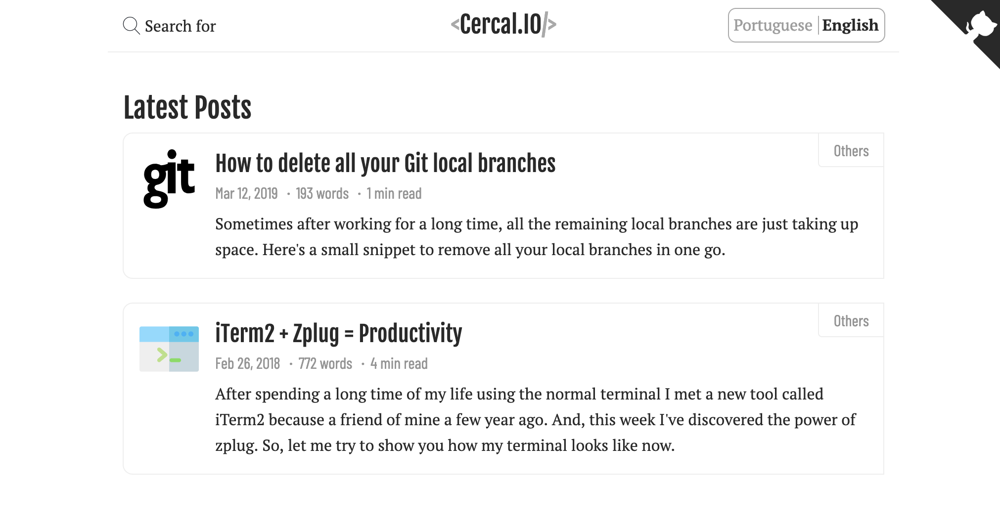

# jpcercal.com

Personal blog and website — [jpcercal.com](https://jpcercal.com/) in production,
per-PR previews at `https://staging.jpcercal.com/pr-<n>/`.

## A brief history of time

> Yes, I know that this title remembers a book title by Stephen Hawking, but at this case it’s about my blog. =)

Well, everything started in 2010 when I decided to have a blog, it has been a long time and many different things happened to myself on the way, however, this is a complete redesign of an old [Symfony](https://symfony.com/) project, that was migrated to [PhalconPHP](https://phalconphp.com/en/), then to [Wordpress](https://wordpress.org/) and finally to text based application (which is the status quo today).

Thanks to all of you for following me through this crazy things called life, to all free services available nowdays on the internet and for the effort that I’ve put on it, now I don’t have to pay anything to have this project running except the domain.

### Screenshots

Well, nothing better than a picture showing how the blog is rendered today, right?



Mobile rendering is captured in `homepage-mobile.png`.

## Architecture (target)

| Concern | Legacy | Target |
|---|---|---|
| SSG | Hugo 0.166.0 extended | Hugo 0.166.0 extended (kept) |
| CSS framework | Bootstrap 5.3.8 slim | Tailwind CSS v4 (Rust Oxide + LightningCSS) |
| SCSS compiler | Ruby Sass via grunt-contrib-sass | Dart Sass Embedded via Hugo Pipes |
| CSS minify | grunt-contrib-cssmin (Node) | LightningCSS (Rust) |
| HTML minify | grunt-contrib-htmlmin (Node) | `hugo --minify` (Go) |
| JS minify | grunt-contrib-uglify (Node) | esbuild (Go) |
| XML minify | grunt-xmlmin (Node) | `xmllint` (C) |
| Images | grunt-contrib-imagemin + svg2png/Inkscape | `oxipng` (Rust) + `oxvg` (Rust) + `mozjpeg` (C) + `resvg` (Rust) |
| Syntax highlight | Pygments (Python) | Chroma (Go, Hugo built-in) |
| Search | Lunr.js 2.3.9 + `search.json` | Pagefind 1.5.2 (Rust, static, PT stemming) |
| Comments | Disqus (`cercal-io`) | removed (no third-party comments) |
| Analytics | Google Analytics 4 | Cloudflare Web Analytics (cookieless beacon, prod-only) |
| Lint | csslint/jshint/VNU (Java) | Biome (Rust) + `html-validate` via Node |
| Link check | — | `lychee` (Rust) |
| Perf audit | grunt-pagespeed (dead API) | `lhci` via Node |
| E2E | — | Playwright |
| Theming | — | Medium-style dark theme (`themes.scss` CSS vars + `data-theme`, OS default, header toggle persisted in `localStorage`, no-flash init) |
| File ops | grunt clean/concat/copy/processhtml/watch | Hugo (Go) + `cp`/`rm` |
| Vendor fetch | `napa` over retired `git://` | removed (no vendor clones left) |
| Runtime | Node 20 + Ruby + Java 8 + Python + Inkscape (old Grunt-era dev machine) | Nix flakes + direnv: Node 26.8.2, native tools, npm dependencies, and Playwright Chromium; optional Docker adapter |
| Hosting (prod) | `gh-pages` branch via GitHub Pages | Cloudflare Pages Direct Upload (`wrangler pages deploy public`) |
| Hosting (staging) | — | `gh-pages` branch repurposed staging-only, path-based per PR |

Toolchain preference order: **native C/Rust binary > Go > Node/Bun**.
See [AGENTS.md](AGENTS.md) for the locked decisions and rationale.

Baseline repo size: 367 tracked files (`content` 242 — 70 post bundles,
`assets` 49, `layouts` 33; Grunt is fully deleted in the final state).
`flake.nix` and `flake.lock` are the toolchain source of truth. The locked
nixpkgs revisions provide Hugo extended, oxipng, oxvg, resvg, Pagefind
extended, lychee, and mozjpeg; `nix/toolchain.nix` checks their exact versions.
The separate Node input preserves Node 26.8.2. `package-lock.json` pins npm
dependencies (including Wrangler); `nix/node-deps.nix` verifies their aggregate
fetch hash. The same
packages are used directly on developer machines and inside CI containers.
At ~1 post/day the deployed file count stays ~1.5–2k/yr — far below the
Cloudflare Pages 20k-file limit.

## Article translations

Every article bundle in `content/posts/<english-slug>/` has Brazilian Portuguese
(`index.md`, Hugo language key `pt`) and English (`index.en.md`) counterparts.
The bilingual completion baseline is **75 bundles / 150 article files**.
Existing URLs and bilingual pairs are preserved; translations use their own
localized `slug` and share the bundle's assets. The folder name always matches
the English file's `slug`; each language's frontmatter controls its public URL,
so Portuguese pages keep their Portuguese URLs. No separate translation or
search framework is needed.

When adding an article, publish both language files together. Keep author,
dates, publication settings, taxonomy identifiers, code blocks and terminal
output unchanged. Translate titles, descriptions, prose, headings, labels,
image alt text and captions. Preserve meaning, register, mood, paragraph
boundaries and order, including historical claims rather than updating them.

Review **every** translation twice: first compare it against the source for
semantic and technical fidelity, then read it independently for author voice
and structure. Keep one translation per commit and record its source revision,
both reviews and checks in the commit body. See
[the completion review ledger](docs/bilingual-review.md).

After building, images and Pagefind indexing, `bin/check-artifact.sh` also runs
`bin/check-bilingual.py`: exhaustive pairing, unique routes, canonicals,
reciprocal language alternates/switches, same-language positional article
references, local links/fragments, images, author routes and per-language
Pagefind page counts. The check derives
the base URL from the output, so it also works with PR-subpath builds:
`python3 bin/check-bilingual.py`. Smoke tests use the real Pagefind index in
both languages and navigate a translated reference and reciprocal switch.

## Local development

Prerequisites: [Nix](https://nixos.org/download/) with `nix-command` and
`flakes` enabled, and [direnv](https://direnv.net/) with its shell hook
installed. No separately installed Node, Hugo, image tools, browsers, or
Docker are required. Optionally install nix-direnv for faster shell caching.

Supported flake systems: Linux amd64/arm64 and macOS Apple Silicon.
Intel macOS is not exposed: this pinned nixpkgs revision does not package
its matching Playwright browser. Use the optional Linux container there.

```shell
direnv allow     # once after reviewing .envrc; reapprove if it changes
hugo server --renderToMemory   # live preview at http://localhost:1313
```

Entering the directory automatically loads the locked configuration and
links read-only Nix-built `node_modules`. If an npm-managed directory or
an unmanaged symlink already exists, move it aside yourself first; the
integration refuses to overwrite it. Do not run `npm ci` against this link.
`.node-version` remains a compatibility reference, not an fnm requirement.

Without direnv:

```shell
nix develop
# or, from the repository:
nix develop --command bash -c 'BASE_URL=https://jpcercal.com/ npm run build'
```

The first entry fetches/builds dependencies; subsequent entries use the Nix
store. The shell configures mozjpeg, browser paths, certificates, fonts,
and Hugo's Node read permissions for the exact dependency/profile paths.

`--renderToMemory` is required: without it `hugo server` writes dev
rendering (localhost URLs, livereload) into `public/` and pollutes the
production artifact.

Production-equivalent build (`BASE_URL` is required):

```shell
BASE_URL=https://jpcercal.com/ npm run build   # clean + hugo --minify
npm run images                                  # bin/build-images.sh
npm run search:index                            # pagefind --site public
```

Design-system preview (staging-only docs, lives outside `content/`):

```shell
cp -r design-system content/design-system && hugo server --buildDrafts --renderToMemory
# delete content/design-system afterwards — it must never be committed
# under content/ or leak into production builds
```

## Deploy

- **Production** (`push` to `main` only): the `image` job builds the
  self-sufficient CI image (`Dockerfile` builds and checks the locked Nix
  toolchain, pushes to GHCR, and exports an immutable image digest).
  All downstream jobs use that digest and do zero dependency installs.
  `build` links the dependencies, runs Playwright smoke tests, then cleans
  their localhost output and runs `npm run build` (requires
  `BASE_URL`) + `bin/build-images.sh` + `pagefind --site public` plus
  the gates (`lint`, `validate:html`, `validate:xml`, `links`, artifact
  isolation, `lhci`), and
  uploads the `public` artifact. `deploy` downloads that artifact and
  publishes it with `wrangler pages deploy public
  --project-name="$CLOUDFLARE_PROJECT_NAME"` (Wrangler 4.147.0 from the
  same container, no floating action-installed CLI;
  `CLOUDFLARE_PROJECT_NAME=jpcercal-dot-com` in CI env; creates the
  project first if missing, idempotent) to `jpcercal.com`. Direct
  Upload — no Pages build quota consumed. Afterwards the
  `cloudflare-pages` job (`bin/verify-pages.sh`) verifies the live site
  and fails the workflow on any missed gate.
- **Staging** (every PR, never touches the Pages project or
  production): CI rebuilds with `--buildDrafts`,
  `content/design-system` copied in, `--baseURL
  https://staging.jpcercal.com/pr-<n>/`, and publishes that path to the
  `gh-pages` branch (`keep_files`, prod `CNAME` stripped, branch custom
  domain `staging.jpcercal.com`). The presence check is a light
  non-blocking file-existence assertion only.
- **DNS** (Cloudflare, one-time repo-admin setup): apex → Pages project;
  `CNAME staging → <user>.github.io` (proxied) with the `gh-pages`
  custom domain set to `staging.jpcercal.com`.
- **Secrets** (repo settings → Actions): `CLOUDFLARE_API_TOKEN` (Pages
  deploy token) + `CLOUDFLARE_ACCOUNT_ID`.

## Optional Docker

```shell
docker build -t jpcercal/jpcercal.com .
docker run --rm -it -p 1313:1313 -v "$PWD:/usr/share/blog" \
  jpcercal/jpcercal.com bash -c \
  'bash bin/nix-node-modules.sh && hugo server --bind 0.0.0.0 --renderToMemory'
```

Builds support Linux amd64 and arm64. The digest-pinned Nix builder
realizes the flake and exports only its runtime closure into a
digest-pinned Debian compatibility base. The final image has no Nix,
compiler, npm installation, or browser download requirement. `/opt/ci/bin`
and `/opt/ci/node_modules` preserve zero-install CI; `blog-env` and
`BASH_ENV` load identical settings for interactive and non-login shells.

Do not mount host-platform Nix `node_modules` into a different-platform
container: move the host link aside first or use a separate checkout.

## Updating dependencies

### Scheduled updates

Dependabot remains responsible for npm, GitHub Actions, and the digest-pinned
Docker adapter. It cannot manage Nix inputs or run a post-update hashing hook.
The **Scheduled dependency locks** workflow supplies that missing step:

- **Daily at 09:00 UTC:** inspect same-repository Dependabot npm PRs, calculate
  `npmDepsHash` using `prefetch-npm-deps` from the trusted, locked nixpkgs, and
  commit it to each PR alongside `package-lock.json`. The PR's flake, toolchain,
  and CI workflow must match trusted main; stale or independently modified PRs
  are reported for manual rebase/review rather than overwritten.
- **Mondays at 10:00 UTC:** resolve the current `nixos-unstable` revision once,
  pin that exact commit in `flake.nix`, generate `flake.lock` NAR hashes,
  synchronize native tool version assertions, and recompute `npmDepsHash`.
  Playwright's npm version moves with the Nix browser driver; Dependabot must
  not update it independently. The separate `nodepkgs` revision and exact Node
  assertions stay unchanged—Node upgrades remain intentional/manual.
- Native proposals pass `nix flake check --no-update-lock-file` (including an
  actual Chromium launch) **before** the bot opens a `build(nix)` PR. An open
  native proposal is never overwritten. Incompatible candidates fail the
  maintenance workflow instead of being published. Nothing auto-merges.
- Commits made with `GITHUB_TOKEN` suppress ordinary push/PR workflows, so the
  bot explicitly dispatches CI on the updated branch. CI checks the stated PR
  number and head SHA before publishing staging; its production deployment
  guards still accept only pushes to main.

The workflow runs only trusted main code. npm PRs contribute lockfile **data**
only: no PR scripts, flakes, or lifecycle hooks execute during hashing. The
hashing/native-build container uses the same digest-pinned Nix bootstrap as
`Dockerfile`, with no GitHub token, checkout credentials, or Docker socket.
Exact revisions and verified hashes remain committed; tracking an upstream
branch at scheduling time never makes builds use a floating input.

**Activation after merge:** in repository **Settings → Actions → General**,
enable **Allow GitHub Actions to create and approve pull requests**. No PAT or
additional secrets are required. The workflow requests narrowly scoped
`contents`, `pull-requests`, and `actions` write permissions; branch protection
and normal review still apply. If policy disallows bot PR creation, a native
proposal cannot be opened and the workflow reports the API failure.

Run it manually from Actions with `mode=npm`, `native`, or `all`; use
`dry_run=true` to calculate and verify without writing branches or PRs.
Locally, from a trusted checkout with Docker and authenticated `gh`:

```bash
python3 nix/update-dependencies.py --mode npm --dry-run
python3 nix/update-dependencies.py --mode native --dry-run
python3 -m unittest discover -s tests -v
```

Dry runs can download dependencies and run builds, but never commit, dispatch,
or open PRs. The container's Nix cache lives in the `dependency-update-nix`
Docker volume. GitHub's schedule is best-effort, so an npm PR may initially
show a hash failure until the companion workflow runs; dispatch it manually
if needed.

### Manual updates

1. Review and change the nixpkgs revisions in `flake.nix`, then run
   `nix flake lock`. The separate `nodepkgs` input preserves exact Node
   26.8.2; update `.node-version`, `package.json`, and version checks
   together when intentionally upgrading it.
2. For npm updates, generate a new lockfile using the pinned Node, without
   writing into immutable `node_modules`:
   `npm install --package-lock-only --ignore-scripts --save-dev --save-exact PACKAGE@VERSION`.
3. Recalculate `npmDepsHash` in `nix/node-deps.nix` using the
   locked nixpkgs `prefetch-npm-deps` utility:
   `nix shell --inputs-from . nixpkgs#prefetch-npm-deps --command prefetch-npm-deps package-lock.json`.
4. Keep Playwright's npm version aligned with the locked browser driver;
   run the checks and full gates below. Stage new flake files before
   evaluating a Git-backed flake; commit both locks and the verified hash.

Nix verifies source/dependency hashes and binary-cache signatures.
Reproducibility is per platform: macOS and Linux artifacts need not be
byte-identical, and external link/performance audits remain network-dependent.
Docker image digests pin bootstrap/runtime bases; image rebuilds are not
claimed to be byte-identical solely because dependencies are locked.

## Verification

From the direnv shell (or `nix develop`):

```shell
nix flake check
nixfmt --check flake.nix nix/*.nix
actionlint
shellcheck bin/nix-node-modules.sh bin/check-artifact.sh
npm run lint
BASE_URL=https://jpcercal.com/ npm run build
npm run images
npm run search:index
npm run validate:html
npm run validate:xml
lychee --config .lychee.toml --no-progress \
  --remap "https://jpcercal.com file://$PWD/public" "public/**/index.html"
bin/check-artifact.sh
npm run lhci
npm run e2e -- e2e/smoke.spec.js
```

The flake check verifies tool versions, native npm binaries, and actual
Chromium launch. Playwright rebuilds `public/` for localhost; rebuild the
production artifact afterwards before publishing it. For rootful containers,
LHCI uses `--collect.settings.chromeFlags="--no-sandbox --disable-dev-shm-usage"`.
Parallel worktrees should select distinct test ports, for example
`PLAYWRIGHT_PORT=1315 npm run e2e -- --workers=2`; the default remains 1313.
The server, Hugo base URL and smoke assertions all use the selected port.
Visual snapshots are platform-specific; compare/regenerate them locally only
when rendering changes, not simply because the toolchain moved to Nix.

The `cloudflare-pages` CI job runs on production pushes only, **after**
the deploy, against the live site (`bin/verify-pages.sh`, `BASE_URL`;
fails the workflow on any missed gate). It asserts, accepting `br` or
`zstd`:

1. Compression served for html/css/js
2. HTTP/2 + HTTP/3 (`alt-svc: h3`) headers
3. Immutable long-cache + fingerprinted asset names
4. TTFB < 1.0s median (over 5 samples)
5. Payload budgets (`search.json` → 404, `design-system/` → 404,
   `pagefind/pagefind-entry.json` → 200, Cloudflare beacon present, no
   Disqus/`gtag(`/`googletagmanager`/Formspree/`api.ipify`/Lunr remnants)
6. SEO (robots disallows `/search/` + `/contact/` and references the
   sitemap, `sitemap.xml` well-formed via `xmllint` and excluding
   search/contact, `hreflang`, valid JSON-LD)
7. `lychee` link check + `html-validate` on the live homepage
8. LHCI performance ≥ 90 and SEO ≥ 90 (blocking; accessibility and
   best-practices ≥ 90 warn) — the live config drops `staticDistDir`
   and passes a single-string `chromeFlags` (`LHCI_CHROME_FLAGS`
   carries `--no-sandbox` for rootful CI containers)

plus a summary table. Staging PRs get a light non-blocking
file-existence check only (`public/index.html` and
`public/design-system/index.html` present, `public/CNAME` absent).

## Project history

The modernization path (`chore/modernize-architecture`, single PR,
stacked revert-safe commits, deploy last) is merged:

0. docs (this README + `AGENTS.md`) → 1. tooling baselines → 2. napa out →
3. CSS (Tailwind + Dart Sass + Less port) → 4. JS modules + esbuild →
5. html/xml → 6. images → 7. highlight + lint → 8. Pagefind → 9. SEO/perf →
10. privacy → 11. design-system → 12. deploy (Pages prod + gh-pages staging +
DNS/CNAME) → 13. slim native-only image, green build.

Follow-up hardening since (one fix PR each): self-sufficient GHCR CI
image with zero-install jobs, Wrangler deploy/project fixes (existing
`jpcercal-dot-com` project, account inference, idempotent create),
`lychee` egress/bot excludes with prod→local `--remap`, live-URL LHCI
without the static server, layout-centering/icon-rhythm fixes with
regenerated visual snapshots, Debian trixie + dependency upgrades, the
Medium-style dark theme, and the Node 24 → 26 upgrade.
