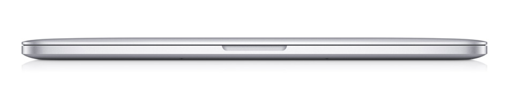
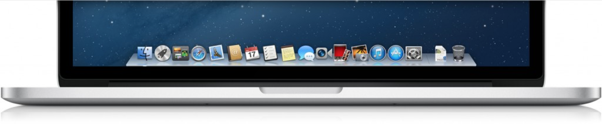

Every day new products are created, some stand out, others not so much. Recently I bought the
revolutionary 15-inch MacBook Pro with Retina display.

Apple's product line is very well respected in the market, the product quality is excellent, and I mean that starting
with its box.

The new MacBook Pro is quite a light laptop, measuring 1.8 centimeters thick and weighing just 2 kilos,
the same as the 13-inch model.

Some points that made me think before buying it were:

* Difficulty upgrading hardware and Price (mainly)
* No _CD/DVD_ drive or _Ethernet_ port

Honestly, I don't miss the optical drive or the _Ethernet_ port.

A laptop that doesn't abandon the performance characteristic of the "Pro" line. Below I present the specifications of
the machine I bought:

* **Operating System**: _OS X 10.8.2 Mountain Lion_
* **Processor**: _Intel Core i7 2.3 Ghz_
* **Memory**: _8 GB DDR3 1600 Mhz_
* **Resolution**: _2880×1800_
* **Graphics**:
  * _Intel HD Graphics 4000_
  * _NVIDIA GeForce GT 650M with 1GB of GDDR5 memory and automatic graphics switching_
* **Storage**: _SSD 256 GB_
* **Size and Weight**:
  * _Height: 1.8 cm (0.71 inches)_
  * _Width: 35.89 cm (14.13 inches)_
  * _Thickness: 24.71 cm (9.73 inches)_
  * _Weight: 2.02 kg_
* **Camera**: _720p FaceTime HD camera_
* **Keyboard and trackpad**:
  * _Standard backlit keyboard, with 78 (US) or 79 (ISO) keys, including 12 function keys and 4 arrow
  keys (inverted "T" arrangement) and an ambient light sensor_
  * _Multi-Touch trackpad with precise cursor control_
  * _Supports inertial scrolling, pinch, rotate, swipe, three-finger swipe, four-finger swipe,
  tap, double tap and drag_

Without a doubt, I made the right choice, I'd always been crazy about getting a Macbook, I tried _Hackintosh_ on my _Dell XPS 15
L502X_, but it didn't come anywhere near the original machine's performance, though it did make my first contact
with Apple's operating system possible, _Mountain Lion (10.8.x)_.

It's a machine for professional use that improves the quality of your work and makes you happy, VERY HAPPY!

I'm another Apple fan, I just don't agree with the prices the Cupertino company charges here in Brazil.

> If you're thinking of buying a Macbook Pro, or already own an Apple product, please leave a comment to
help those who still have questions.
