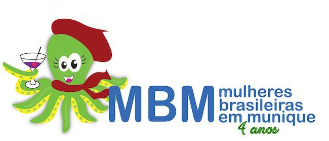

When we make a change in our lives, we leave our comfort zone and know we'll have to face many fears and challenges before we feel secure. That's what happened to us too when we arrived in **Munich**, *lost*, full of *fears*, looking for **support** in each other and in our family back in **Brazil**. Soon I felt it wasn't enough, I was feeling alone and with a hole of **homesickness** in my heart.

And then the lovely women of [MBMs](https://www.facebook.com/groups/mbmunique/) appeared in my life with an invitation to a meeting of *Brazilian Mothers in Munich*, it was my salvation and I'm eternally grateful for it. A simple chat among women and mothers gave me strength not to give up and not to fall ill, they gave me affectionate, emotional support and of course advice that was fundamental to my successful journey.

The *MBM* do commendable nonprofit social work, there are meetings to empower these women to awaken their entrepreneurial, professional side and, above all, to raise our self-esteem. During the mothers' meetings - this is one of the *MBM* projects - we have the opportunity to share our worries, ease our longing for **Brazil**, share our culture with the children, have a *delicious* coffee, and there's still time to develop beautiful **friendships** over a good conversation.

In the end, the secret to filling part of that hole called homesickness was finding them and discovering that building my routine here would give me independence and security. Of course, the bonds of friendship formed in this local group play an important part in adapting, mainly through exchanging information. So finding this sisterly comfort made me feel part of the world again.

This facebook group isn't just another group, its purpose is to support and integrate **Brazilian** **Women** in **Munich**, and to make this happen, the *MBMs* are extremely organized in managing the group. I can't fail to mention that behind everything there are wonderful human beings interested in helping us, they don't do things for us but guide us on how to do them. Best of all, they're cheerful and share that joy with newcomers, there you find a little piece of Brazil in Munich. So good! As one of the dear women says, “here one helps another and everyone helps each other”, and you really experience that energy at the gatherings.

It's very important to point out that the *MBMs* develop many projects that make the group stand out, among them I can mention:

## Meeting of Moms, Babies and Supporters

This is a program for **mothers** and their **babies** (from 0 to 2 years old), and also *all women* who want to ease their longing for fellow Brazilian women, at this gathering there's lots of exchange about motherhood and living in **Munich**, lots of support for newcomers, creating a sisterly network that's very important for those of us who don't have family nearby. And we also get a delicious coffee, it feels like home (of course I'm talking about Brazil), sometimes there's even *cuscuz*, carrot cake with chocolate icing and lots of other treats.

## Minha Vez

This is a project focused on women's **professional** role, with monthly *workshops* where a guest shares her rich professional knowledge with the others, though the focus is always geared toward the group's profile. These speakers may or may not be currently working. This way the group shares different professional experiences, allowing participants to gain knowledge and perhaps take initiatives in their lives and/or professional careers. Of course, this project nurtures new friendships, and to celebrate this exchange of information there's a shared meal at the end of each talk, a delicious *brunch* where *workshop* participants socialize and *swap stories*.

## Descoladas

Focused on unwinding, reaffirming once again the self-esteem of women who break away from their daily routine of children, husband, home and work to meet up with friends. Enjoying a good film together, a relaxed chat at a restaurant, theater, or perhaps discovering new places. All this combined with good laughs makes this program an excellent opportunity to relax and feel the *MBMs'* sense of well-being.

## Papo Café

Run in partnership with the Bean Me Up Kaldi Blog (now offline), this is basically a monthly gathering at a café in **Munich**, during this visit the blog's author writes a post about her thoughts on the place, so we have a combination of appreciating good coffee and a good moment of socializing among the group's members. Get ready for lots of sharing of experiences in **Germany**, relaxation, hearty laughter and more bonds built or strengthened.

## Quintal Brasil

As a supporter of Portuguese as a Heritage Language, *MBM* spreads culture through this project, which consists of monthly gatherings for children from 0 to 4 years old, promoting musicality through circle songs, traditional games and crafts that fill families with pride. This continuity of Brazilian culture is a good opportunity for parents and children to interact, share experiences of the little ones' age group, and everyone can enjoy a moment rich in affection and togetherness within the group.

## Art for little Brazilians

In partnership with art teacher Madalena Soares from [Kinder Fórum Van de Loo](http://www.kinderforumvandeloo.de/), children create lovely crafts together with their parents, a pleasant moment of bringing families closer. During the process, all kinds of materials are used as the raw material for their works. This happens once a month and brings together the best aspects of learning for little ones, socializing, developing artistic skills and lots of affection.

## Birthday Party at the End of the Year!

This event is the *MBMs* group's annual celebration, celebrating everything done over the past year. It's a beautiful party with a different theme every year, not to mention the good music, Brazilian treats, giveaways and lots of fun. As expected, each year brings more supporters and reasons to celebrate.

In addition, *MBMs* takes part as a partner in other projects happening in **Munich** involving **bilingualism**, **entrepreneurship** and **encouraging reading**. In short, it's a group promoting our culture outside Brazil and deserves every support to continue its purpose.

Come join [MBM](https://www.facebook.com/groups/mbmunique/) too, come on!
