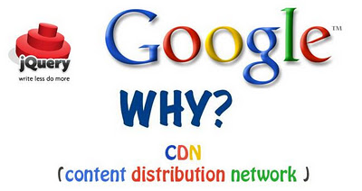
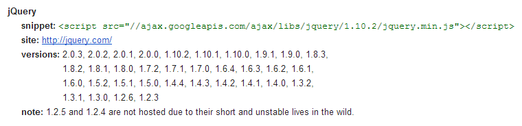

_jQuery_ is a library widely used for web development, and in _WordPress_ we have this library included in the _default_ installation package.

In this article, I'll show you how and why you should replace _WordPress's_ _default_ _jQuery_ with _jQuery_ from _Google CDN (Content Distribution Network)_.

**But why should you replace it?**

Generally speaking, you should do this so the script loads faster for the end user.

Here are the points that should lead you to adopt this practice.

**Caching**

Perhaps the great benefit of including _jQuery_ hosted by _Google_ is the chance that your visitors won't even need to download _jQuery._ This happens because, if a user has already visited another site using _jQuery_ hosted by _Google_, they'll already have the library in their [browser]( "Web Browsers") cache, thus avoiding a new request.



**Low Latency**

_Google_ has _jQuery_ distributed geographically across several servers, so when a browser requests a _URL_ for the _jQuery_ library, the file will be downloaded from the _Google_ server closest to the end user's location.

**Parallel Requests**

Another advantage of using it is that your server won't be overloaded, and there will be parallel requests to complete your website page's loading cycle.

**Free**

The main reason you should use this service is that it brings you the benefits mentioned above and, above all, it's free.

**How do I replace WordPress's default jQuery?**

This is very simple, first open the directory containing the theme you're using, `/wp-content/themes/NOME-DO-SEU-TEMA/`. Then find the file called `functions.php` and add the following lines at the end of the file:

```php
<?php
/**
 * Remove o jQuery utilizado pelo WordPress e adiciona
 * o jQuery do Google CDN nas páginas do Website.
 *
 * @author João Paulo Cercal <jpcercal@gmail.com>
 */
function jquery_from_google_cdn() {

  // Se a página carregada não for da área administrativa...
  if (!is_admin()) {

    // Remove o registro da biblioteca jQuery que é utilizada pelo WordPress
    wp_deregister_script('jquery');

    // Registra o jQuery do Google CDN
    wp_register_script(
      'jquery',
      'http://ajax.googleapis.com/ajax/libs/jquery/1.7.2/jquery.min.js',
      false,
      '1.7.2'
    );

    // Adiciona o jQuery do Google CDN
    wp_enqueue_script('jquery');
  }
}

// Hook executado na inicialização
add_action('init', 'jquery_from_google_cdn');
```

If the `functions.php` file doesn't exist in this directory, you should create it and add the following lines as the file's content:

```php
<?php

/**
 * Remove o jQuery utilizado pelo WordPress e adiciona
 * o jQuery do Google CDN nas páginas do Website.
 *
 * @author João Paulo Cercal
 */
function jquery_from_google_cdn() {

  // Se a página carregada não for da área administrativa...
  if (!is_admin()) {

    // Remove o registro da biblioteca jQuery que é utilizada pelo WordPress
    wp_deregister_script('jquery');

    // Registra o jQuery do Google CDN
    wp_register_script(
      'jquery',
      'http://ajax.googleapis.com/ajax/libs/jquery/1.7.2/jquery.min.js',
      false,
      '1.7.2'
    );

    // Adiciona o jQuery do Google CDN
    wp_enqueue_script('jquery');
  }
}

// Hook executado na inicialização
add_action('init', 'jquery_from_google_cdn');
```

**But if I don't use WordPress, can I use Google CDN?**

Of course you can! To implement this on your website, you can change the line where you include the
_jQuery_ library, changing the **src** attribute to the _Google CDN_ address. This line is usually
located in the **head** block of the **html** document, or at the end of the page before the tag .

The line you should change should look like the code below:

```html
<script type="text/javascript" src="./js/jquery.min.js"></script>
```

Change the line mentioned above to:

```html
<script type="text/javascript" src="//ajax.googleapis.com/ajax/libs/jquery/1.7.2/jquery.min.js"></script>
```

**jQuery Versions on Google CDN**

In the image below you can check the _jQuery_ versions you can use on _Google CDN_.



**Done!**

Save the changes, and when you reload your website you'll already be using _jQuery_ provided by _Google CDN_.

> Do you have questions or suggestions? Did you already know about or use this practice in your projects? **Leave a comment!**
