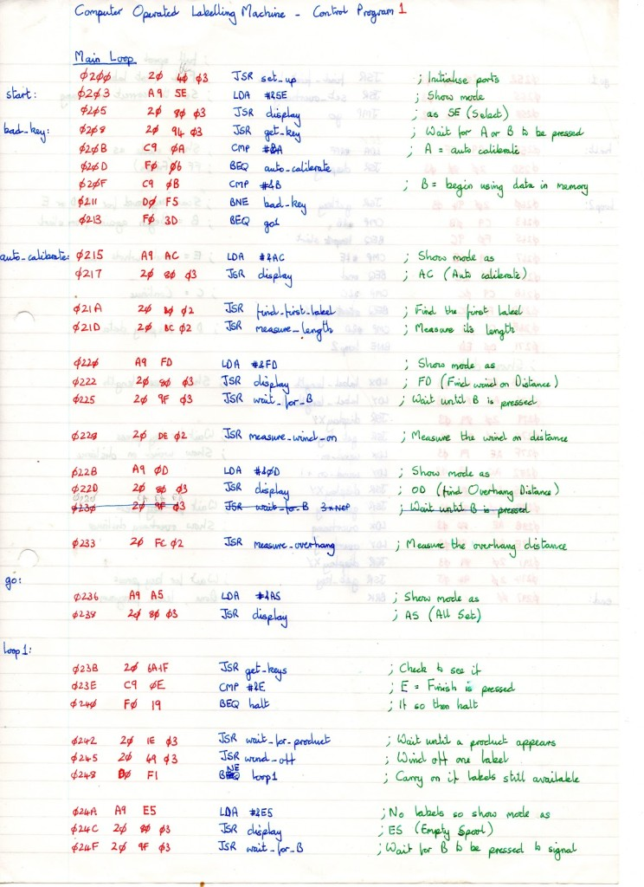

_Jonh Graham-Cumming_, a programmer from 1985, shows what programming was like back then, according to him it was quite
common to write code on sheets of paper because of the limitations of the machines they used in those days.

Today, when we see programmers at companies like Facebook writing code on modern machines, we don't
imagine how difficult it was to get here.

However, the technology industry has evolved extraordinarily and quickly in recent decades. The image below shows the
result of configuring a machine that put packaging on bottles, the algorithm was developed by _Jonh_.

"Of course, writing code like this is very difficult. First you had to write the code (the blue part), then
translate it into machine language (the red part) and deal with memory allocation for each instruction. At that
time, I didn't have a calculator capable of hexadecimal operations, so I did most of the necessary
operations", explains the programmer.

Perhaps a sheet of paper is a tool missing from programmers' desks, if we weigh the efficiency of code
written first on paper and then weigh code written on modern computers, we'll get surprising
results. Code written on paper had to be thought through, rethought and thought through again so there would be
absolutely no error.

This account from _Jonh_ is surprising to everyone, but we should reflect on what a good decade we live in, and we shouldn't
think about how much work it took to program a packaging machine in 1985, but rather the benefits and conveniences we
can enjoy today and which _Jonh_ certainly values more than anyone.
