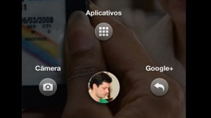

On April 04 (last week), the launch event took place for _Facebook's_ new functionality
called "_Home_". This new feature was presented by _Mark Zunckerberg_ himself, the functionality is
available for _smartphones_ running the _Android_ operating system.

With the aim of turning any phone into a personalized device on the social network, _Home_ will use the
phone's home screen as the _Facebook_ homepage, overlaying the other applications on your device,
so when you turn on your device you'll be connected to _Facebook_.

In other words, you'll be able to follow what your friends are doing: the latest posts; photos; comments; likes
and received messages.

Another new feature is _Chat_, which has been improved and is now called _Chat Head_, it will integrate with your SMS,
making it more dynamic, and when you want to end the conversation, just drag the icon and dismiss the feature,
and in the same way you can accept messages through this functionality.
Your profile photo will stay at the bottom of the screen continuously, and to see your traditional applications,
just click the icon with your photo and slide it on the screen.

For now, the "_Home_" application will be available only for _Android_, it will launch on _Google play_ at a cost
of USD 99.99 – initially limited to the American market – on April 12 and will receive monthly
updates. A version for _tablets_ will also be released, but no date has been set yet.
