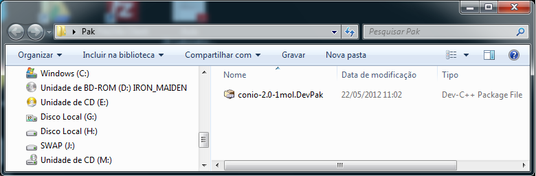
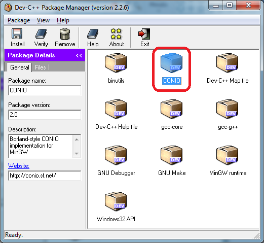
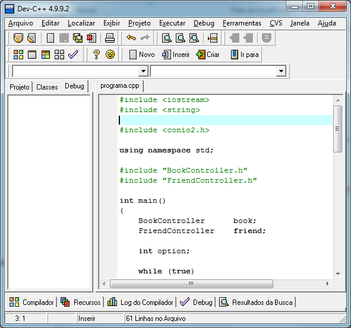

I prepared this document for some colleagues who were having difficulty installing the **Conio2.h** package for the
**Dev-C++ IDE**. This package includes a library with functionality for developing applications written
in **C/C++**.

To continue with this guide, you need to have **Dev-C++** installed.

First we should [Download the Conio2.h package from SourceForge](http://sourceforge.net/projects/conio/files/devpak/CONIO%202.0/conio-2.0-1mol.DevPak/download).

After downloading it, we should run the file with the _"DevPak"_ extension.

A setup will appear, click the _"Install"_ button as shown in the image below:

Now click the _"Finish"_ button as shown in the image below:

Let's make sure the **Conio2.h** library was installed, as shown in the image below:

Now we need to configure Dev-C++ to use the library. Go to the _"Tools"_ **>** _"Compiler Options"_ menu, as shown in the image below:

Add the following command **"-lconio"**, as shown in the image below:

Now you can enjoy the **Conio2.h** library.

