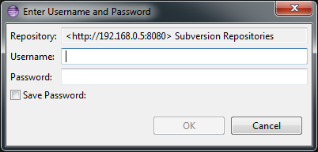
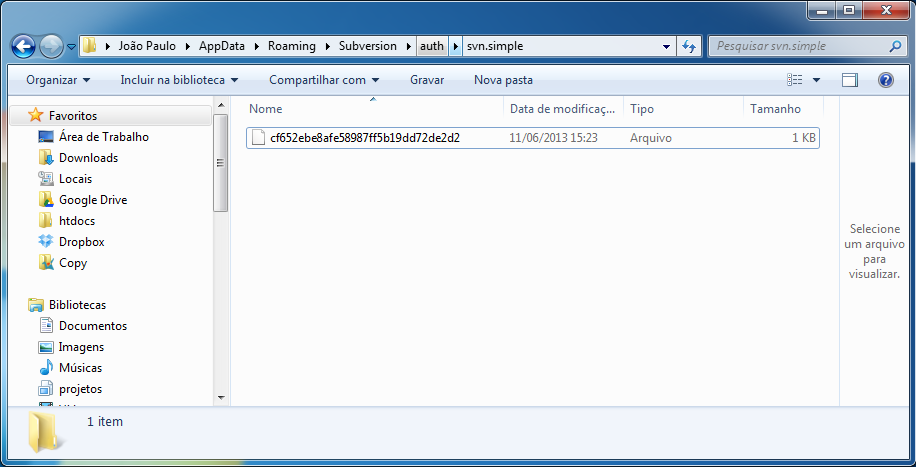

Today we'll learn how to change the user logged into _Subversive_, the _Eclipse_ IDE plugin. Well, this
guide can also be useful if you've changed or lost your username and/or password and can't authenticate with the
_SVN_ Server. Unfortunately this plugin doesn't provide a graphical interface so you can simply _log off_
and _log in_ again.

However, we can do this very simply. Anyway, enough rambling, let's get straight to what matters.

When we _logged in_ and checked the option to save the password, _Subversive_ created an encrypted file
containing your access details, which cannot be edited. So, to change your username and password, just delete
this file, and when you perform an action in _Subversive_, a window will appear again where you'll
enter your username and password.

The file you need to delete is in the following directory: `%APPDATA%\Subversion\auth\svn.simple`

