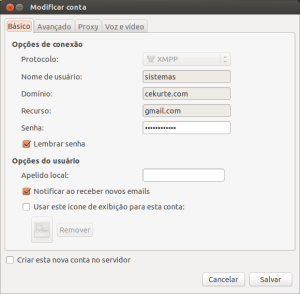
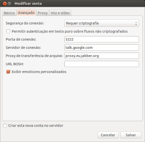

Hey folks, I decided to put this tutorial together after searching **N** times for _"How to configure Google Talk for Google
Apps in Pidgin"_. Well, if you have this problem, you're about to solve it.

To do this, we just need to configure the client.

_Note: This tutorial can also be useful for configuring other instant messaging clients._

Below I list the settings needed for you to log in successfully:

To open the settings, go through the menu: "Contas" > "Gerenciar Contas". Then select an account and click
the "Modificar" button

**On the "Básico" or **"Basic"** tab:**

* Protocol (Protocol): XMPP
* Username (Username): your account's user
  * Your account will look like this email: **usuario**@dominio.com, so you'll fill in the
  "Username" field with the value shown in bold, to the left of the at sign.
* Domain (Domain): Your account's domain
  * If your account were the same one shown above (usuario@**dominio.com**), your domain would be: dominio.com
* Resource (Resource): gmail.com
* Password (Password): sua-senha

**On the "Avançado" or "**Advanced**" tab:

**

* Connect port (Connect port): 5222 (if the firewall blocks this port, try 443)
* Connect server (Connect server): talk.googole.com
* File transfer proxy (transfer proxies): proxy.jabber.org or proxy.eu.jabber.org

After applying the settings above, connect and you'll have your account working in the Pidgin instant
messaging client.

> Questions? Did the tutorial work? **Contribute by leaving your comment!**
