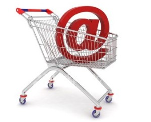

In the first half of 2012 e-commerce sales increased by around 20% compared with the same period in 2011,
representing R$ 10.2 billion in sales, these figures were provided by _e-bit_, which believes this
phenomenon was due to increased employment, better income distribution, easier access and low costs for
_web_ browsing. However, the promotional tool _email marketing_ played a major role, since 5.6
million consumers made their first purchase after receiving stores' offer campaigns by _email_.

It's been a long time since _email marketing_ stopped being a mass communication tool and became personalized
messages based on users' profiles, increasing the chances of turning users into actual customers.

However, we know that providers' filters are adopting increasingly strict measures to prevent their users'
inboxes from being invaded by messages that don't interest them, and because of this, they're analyzing
the response that emails generate in these users, and when there's no response it's understood that they're not relevant to
the user, sending the next emails to the spam folder.

Developing _email marketing_ campaigns can boost or bring down an investment. Finding appropriate language,
offering what the customer wants and adding value to what's offered are characteristics that determine the campaign's
success.

> Do you or your company already run any _email marketing_ campaigns? How about sharing your experiences with us,
leave your comment.
