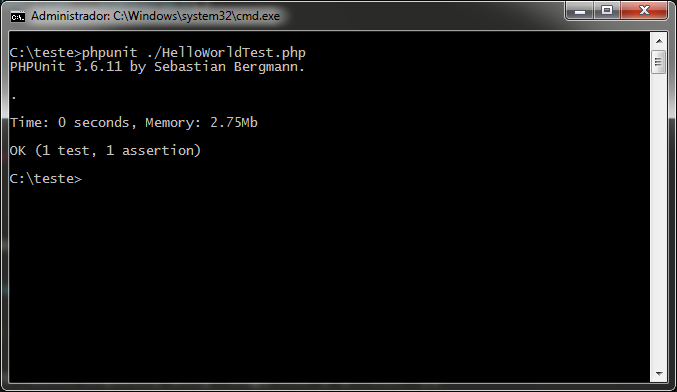

Hello person(s), today I'll present a step-by-step guide to installing PHPUnit on Uncle Bil Gates' famous
operating system, Microsoft Windows 7 (Seven), before continuing with the tutorial I wanted to talk a little about unit
tests and test-driven development (the famous TDD – Test Driven Development).

**So, what is TDD?**

TDD is a method for building software, not just testing it. Through the "Red", "Green",
"Refactoring" process, you notice that the code becomes clean, organized and best of all, working!

```shell
phpunit --version
```

Now open a text editor and type the following source code:

```php
<?php

class HelloWorld
{
    public function msg( $message )
    {
        return $message;
    }
}

class HelloWorldTest extends PHPUnit_Framework_TestCase
{
    public function testHelloWorld()
    {
        $obj = new HelloWorld();

        $this->assertEquals( $obj->msg('Olá') , 'Olá' );
    }
}
```

Save the file as: **HelloWorldTest.php**

I saved the file in the directory: **C:\teste**



> Now everything is working! Be a new developer from today onward and use unit tests, if you have
questions, leave us a comment.
