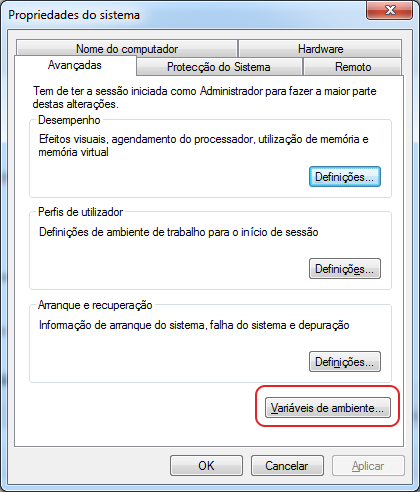
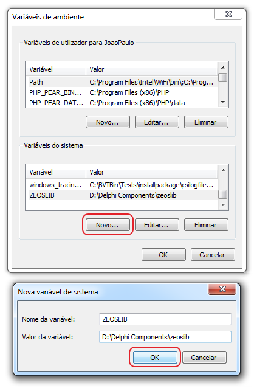
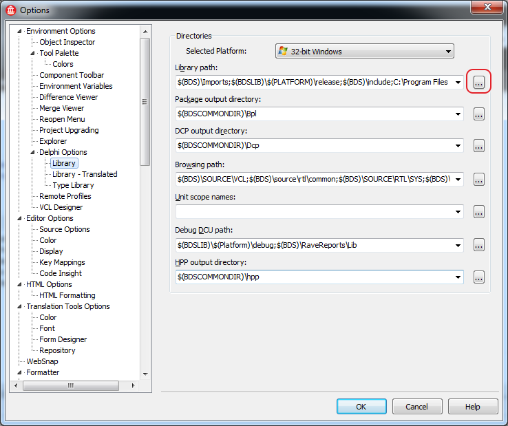
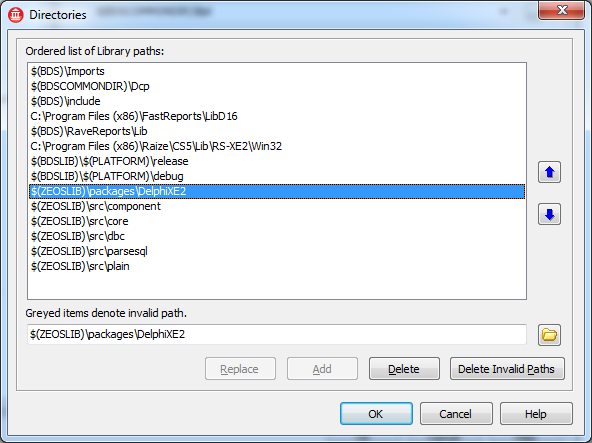
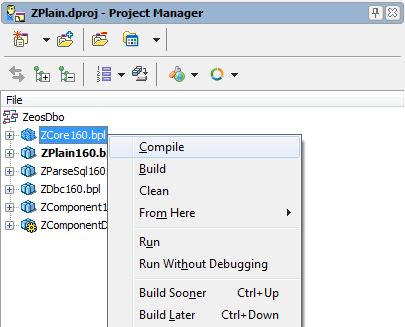
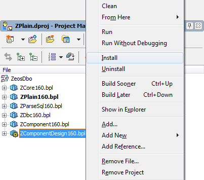
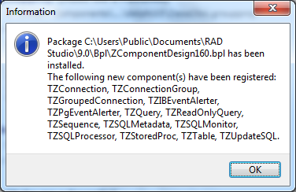

After having difficulty installing **ZeosLib** in **Delphi XE2**, I decided to share
_"the way through"_.

**The ZeosLib Library**

The _ZeosLib_ library consists of a set of tools so you can have a native database
connection, meaning a connection without auxiliary drivers such as _ODBC_.

_ZeosLib_ is an **open-source** project, its installation isn't that complex, but here's the recipe, just
follow the steps without skipping _"any ingredient"_.

**Downloading the ZeosLib Library**

Well, first download the latest version of _ZeosLib_ directly from the Official SVN repository.

If you use **SVN** for version control, you can use the following command:

```shell
$ svn checkout https://zeoslib.svn.sourceforge.net/svnroot/zeoslib/trunk/ zeoslib
```

If you use **GIT** for version control, you can use the following command:

```shell
$ git svn clone --revision HEAD https://zeoslib.svn.sourceforge.net/svnroot/zeoslib/trunk/ zeoslib
```

**Adding the ZeosLib directory to Delphi's Library Path**

Let's add an _environment variable_ in _Windows_, if you use _Windows Seven_ like me, go to:
Control Panel > System and Security > System. In the sidebar click "Advanced System Settings",
a window like this will appear:



Click the button identified in the figure as "Environment Variables…" and a window like the one below will appear:



Fill in the box with the following values:

* **Variable name:** _ZEOSLIB_
* **Variable value:** _PATH-onde-você-baixou-o-zeoslib_, in my case: _D:\Delphi Components\zeoslib_

Now we'll add the _ZeosLib_ path to _Delphi's Library Path_, to do this, click the "_Tools_" menu and
select "_Options..._"

A screen like the one below will appear:



Click the "..." button indicated in the figure above to add a new _path_.

Add the following paths:

* **_$(ZEOSLIB)_\packages\DelphiXE2**
* **_$(ZEOSLIB)_\src\component**
* **_$(ZEOSLIB)_\src\core**
* **_$(ZEOSLIB)_\src\dbc**
* **_$(ZEOSLIB)_\src\parsesql**
* **_$(ZEOSLIB)_\src\plain**

In the end, you'll have a result similar to this: 

Click "OK", close the remaining windows and restart Delphi XE2.

**Opening the ZeosLib project in Delphi XE2**

With Delphi XE2's Library Path configured, we'll install ZeosLib.
Click the button: **File** > **Open Project… (Ctrl + F11)**

Go to the folder where you downloaded ZeosLib, in my case: _D:\Delphi Components\zeoslib_. Then open the
**packages** > ** DelphiXE2** directory and open the project called **ZeosDbo.groupproj**.

**Compiling ZeosLib in Delphi XE2**

You should compile the packages in the following order:

* **ZCore160.bpl**
* **ZPlain160.bpl**
* **ZParseSql160.bpl**
* **ZDbc160.bpl**
* **ZComponent160.bpl**
* **ZComponentDesign160.bpl**

The image below illustrates this process:



After you compile all the packages, you can finally install it. Click the
**ZComponentDesign160.bpl** package and select "Install", as shown in the image below:



If everything goes well, a message like this will appear:



We've finished installing the library, restart _Delphi XE2_ and make good use of the _ZeosLib_ component.

> If you have questions or a problem with installation, leave us a comment.
