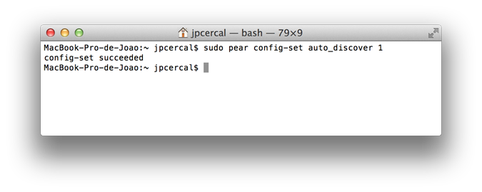
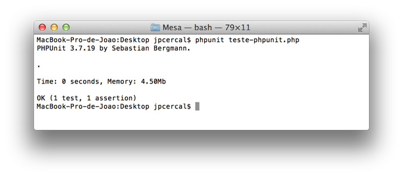

Hello, today I'll demonstrate how to install PHPUnit on _Apple's_ operating system. This guide should also be
compatible with earlier operating systems in the apple family, such as _Snow Leopard_ and _Lion_.

If you use the Microsoft Windows operating system, you can read this other tutorial:
[Installing PHPUnit on Windows]( "Installing PHPUnit on Windows").

Well, let's install PHPUnit on OSX.

Open the Terminal and check whether _PEAR_ is already installed with the following command.

```shell
$ pear version
```

If it isn't installed, the command's output should look like:

```shell
pear: command not found
```

If you saw that message, you should follow this tutorial before continuing with the PHPUnit installation:
[Installing PEAR on OSX 10.8 Mountain Lion]( "Installing PEAR on OSX 10.8 Mountain Lion").

Let's continue the installation, open the Terminal and run the following command:

```shell
$ sudo pear config-set auto_discover 1
```

You'll see a message like the one shown in the image below:



Once that's done, you should run the following command in the terminal to install PHPUnit:

```shell
$ sudo pear install pear.phpunit.de/PHPUnit
```

PHPUnit was installed in the following directory: /Users/**nome-do-seu-usuario**/pear/share/pear/**PHPUnit**, to
use it in your scripts, just include/check that your php.ini include_path already contains the PEAR directory.

To check this setting in your _php.ini_ file, run the following command in the terminal:

```shell
$ cat /etc/php.ini | grep include_path
```

Your _include_path_ will be displayed and should contain the following line:

/Users/**nome-do-seu-usuario**/pear/share/pear

If your include_path doesn't have the line mentioned above, you should open the _php.ini_ file and at the end of
_include_path_ add ":/Users/**nome-do-seu-usuario**/pear/share/pear" (without quotes).

Now let's create a test class to check whether phpunit is working correctly.

Create a php file called _"teste-phpunit.php"_ and add the following lines:

```php
<?php

class HelloWorld
{
    public function msg($message)
    {
        return $message;
    }
}

class HelloWorldTest extends PHPUnit_Framework_TestCase
{
    public function testHelloWorld()
    {
        $obj = new HelloWorld();

        $this->assertEquals($obj->msg('Olá') , 'Olá');
    }
}
```

Now run the test with the following command in the terminal:

```shell
$ phpunit teste-phpunit.php
```

An image like this will be displayed, reporting that all tests ran successfully.



> Do you have any questions? Do you already use PHPUnit in your projects? Leave a comment.
