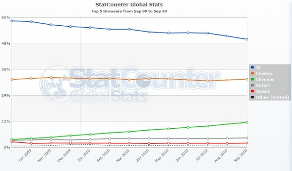

Microsoft's **Internet Explorer** [browser]( "Web Browsers")
had less than 50% market share in September, recording the biggest decline in its
history. According to market analysis company [StatCounter](https://gs.statcounter.com/ "StatCounter"), global browser
usage was 49.87%, a much lower figure compared with when the program won the battle against
[Netscape]( "Web Browsers") in the 90s, capturing
most of the market.

_StatCounter_ also says that _Mozilla's Firefox_, in second place, has 31.5% of the browser market,
while _Google's Chrome_ is third, with 11.54%. However, the program has tripled its usage since the
same period last year. According to a report from the _Softpedia_ website, _Chrome_ is the fastest-growing browser.
The rest of the market is divided among browsers with smaller shares, such as _Opera_ and _Apple's Safari_.

Two years ago, _Internet Explorer_ had two-thirds of the _browser_ market, and the analysis company believes
that not even the new version, _IE 9_, can reverse the situation.

_StatCounter's_ CEO, Aodhan Cullen, said in a statement that _"this is a great moment in the browser wars"_.
_"I believe the agreement Microsoft made with the European Union to allow users to choose their
browsers in Windows contributed to this decline in Internet Explorer"_.

Source: [G1](http://g1.globo.com/tecnologia/noticia/2010/10/internet-explorer-tem-menos-de-50-da-participacao-de-mercado.html "G1")
