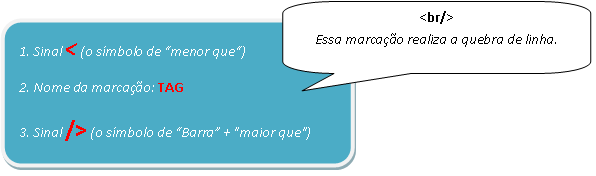
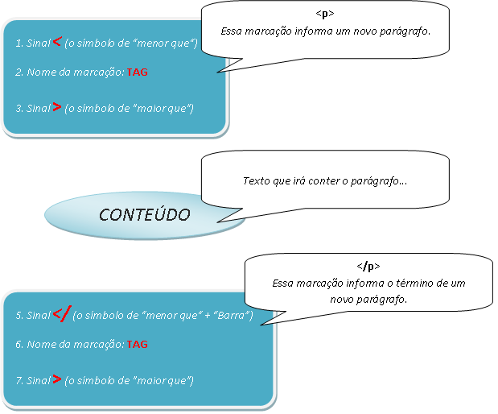
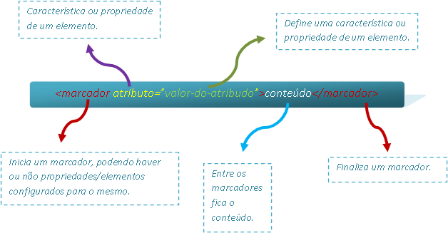

An **HTML** (_HyperText Markup Language_) document is a set of instructions in _ASCII_ format used to create
hypertext documents that can be viewed in a WWW
[Web Browser]( "Web Browsers")
(_such as Internet Explorer, Mozilla Firefox, Apple Safari, etc_).

To create an _HTML_ page you only need a text editor that lets you save files in
"_ASCII with line breaks_" format, such as "_Notepad_" or_ "Sublime Text 2″ _on Windows.

To view the _HTML_ document, simply open it in your favorite browser.

The _HTML_ language consists of **tags** (_markers_), which the browser interprets and displays.

HTML markup follows this pattern:

* **NOTE:** the image below illustrates the syntax of the HTML markup language **without** a closing pair.



* **NOTE:** the image below illustrates the syntax of the HTML markup language **with** a closing pair.

HTML markup language syntax
with a closing pair

As in the second image – generally speaking – tags appear in pairs, for example:

```html
<p>Esse texto contém um parágrafo</p>
```

Where:

`<p>` Indicates that a paragraph should be created.

`</p>` Indicates that the paragraph is finished.

The symbol that ends a given piece of markup is the same as the one that starts it, preceded by a slash (**/**).

There are exceptions to this paired behavior of markup. For example, the tag indicating a line break, `<br>`,
does not need a matching tag either, nor do others such as `<hr>`.

Tags can optionally contain **attributes**. An attribute defines a _characteristic_ or _property_ of an
_element_. It is always included in an element's (_tag's_) initial (_opening_) tag, using the syntax:
**attribute-name="_value_"**.

An element can have several attributes, separated by blank space(s).

The image below illustrates HTML markup language syntax using attributes:



**Important**: _HTML_ does not distinguish between _uppercase_ and _lowercase_ (_it is NOT
"[case sensitive]( "The CamelCase Convention")"_). So the notation
`<title></strong>` **is equivalent to** `<strong><TITLE></strong>` or `<strong><TiTlE></strong>. </p></title>`.

See an example of an HTML page below:

```html
<html>
    <head>
        <title>Título da Página</title>
    </head>
    <body>
        <p align="center">Olá Html!</p>
    </body>
</html>
```

**Research Sources**:

* _http://www.ic.unicamp.br/~celio/inf533/docs/markup.html_
