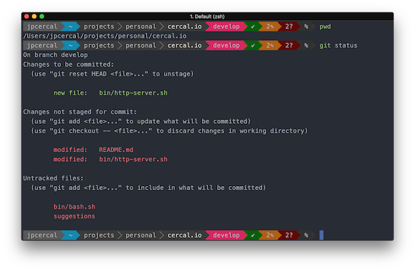
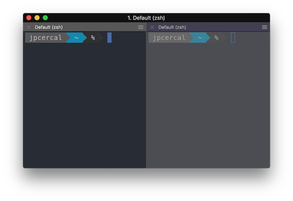
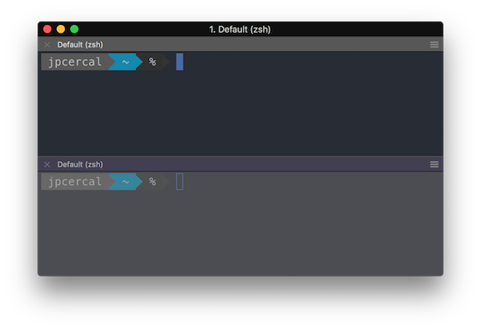
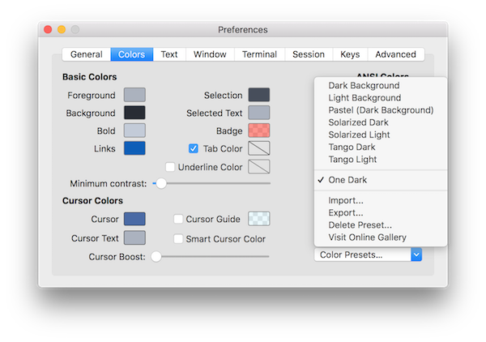
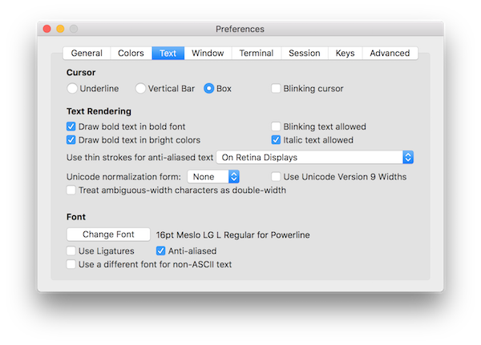

Depois de passar muito tempo da minha vida usando o terminal normal, conheci uma nova ferramenta chamada iTerm2 por causa de um amigo há alguns anos. E, nesta semana, descobri o poder do zplug. Então, aqui está um breve tutorial de como conseguir algo parecido com isto:



## iTerm2

Esta é uma ferramenta como o aplicativo nativo de terminal fornecido pela Apple, com muitos recursos que você pode simplesmente [conferir aqui](https://www.iterm2.com/). Ela permite personalizar tudo, do preenchimento automático ao destaque de sintaxe.

Mas o recurso mais interessante para mim se chama `Split Panes`.

### `Cmd ⌘ + D` divide o painel verticalmente



### `Cmd ⌘ + Shift + D` divide o painel horizontalmente



### Esquema de cores

Para continuar a personalização do seu terminal, vamos instalar o esquema de cores `One Dark` no seu aplicativo iTerm.

```shell
git clone -b master --depth=1 https://github.com/bahlo/iterm-colors.git ~/iterm-colors
```

Esse comando baixará alguns presets, incluindo o tema `One Dark`. Para instalá-lo no iTerm, pressione `Cmd ⌘ + I` e vá a `Colors > Color Presets > Import...`, lá você pode selecionar o preset que gostaria de importar.

Observe que os presets ficam no diretório `~/iterm-colors/colors/*.itermcolors`.



### Fonte Meslo

Outra coisa a instalar é uma boa fonte, estou usando `Meslo`, se você quiser a mesma pode instalá-la assim:

```shell
git clone https://github.com/powerline/fonts.git && cd fonts && ./install.sh
```

E, para usar essa fonte no iTerm, pressione `Cmd ⌘ + I` e vá a `Text > Change Font > Family > Meslo LG L for Powerline`. Não se esqueça de desabilitar a opção `Use a different font for non-ASCII text`.




## Zplug

É um gerenciador de plugins do Zsh como oh-my-zsh, prezto e antigen.

Algumas vantagens segundo a [página do projeto](https://github.com/zplug/zplug):

* Pode gerenciar tudo
    * Plugins do Zsh/comandos UNIX no GitHub e Bitbucket
    * Arquivos Gist (gist.github.com)
    * Plugins gerenciados externamente, por exemplo, plugins/temas do oh-my-zsh e prezto
    * Artefatos binários no GitHub Releases
    * Plugins locais
    * etc. (você pode adicionar suas próprias fontes!)
* Instalação/atualização paralela super-rápida
* Suporte a carregamento sob demanda
* Suporte a branch/tag/commit
* Hooks pós-atualização, pós-carregamento
* Dependências entre pacotes
* Diferentemente do antigen, não exige arquivo de plugin ZSH (*.plugin.zsh)
* Interface interativa (fzf, peco, zaw e assim por diante)
* Mecanismo de cache para reduzir o tempo de inicialização

Este é um framework para gerenciar sua configuração do zsh. Para instalar essa ferramenta, você deve executar este comando:

```shell
brew install zplug
```

### Meu arquivo de configuração `~/.zshrc`

Este é o arquivo de configuração que estou usando agora. Para conseguir usá-lo, você precisa instalar estas dependências antes de continuar:

```shell
pip install psutil
pip install powerline-shell
brew install peco
```

Agora, copie e cole este conteúdo no seu arquivo `~/.zshrc`.

```shell
###########################################################
# Pre configuration

# Define the environment variable ZPLUG_HOME 
export ZPLUG_HOME=/usr/local/opt/zplug

# Loads zplug
source $ZPLUG_HOME/init.zsh

# Clear packages
zplug clear

###########################################################
# Packages

zplug "zsh-users/zsh-syntax-highlighting"
zplug "zsh-users/zsh-autosuggestions"
zplug "zsh-users/zsh-completions"
zplug "paulmelnikow/zsh-startup-timer"
zplug "tysonwolker/iterm-tab-colors"
zplug "desyncr/auto-ls"
zplug "momo-lab/zsh-abbrev-alias"
zplug "rawkode/zsh-docker-run"
zplug "arzzen/calc.plugin.zsh"
zplug "peterhurford/up.zsh"
zplug "jimeh/zsh-peco-history"
  
###########################################################
# Theme

zplug "b-ryan/powerline-shell"

function powerline_precmd() {
    PS1="$(powerline-shell --shell zsh $?)"
}

function install_powerline_precmd() {
  for s in ${precmd_functions[@]}; do
    if [ "$s" = "powerline_precmd" ]; then
      return
    fi
  done
  precmd_functions+=(powerline_precmd)
}

if [ "$TERM" != "linux" ]; then
    install_powerline_precmd
fi

###########################################################
# Install packages that have not been installed yet
if ! zplug check --verbose; then
    printf "Install? [y/N]: "
    if read -q; then
        echo; zplug install
    else
        echo
    fi
fi

zplug load

###########################################################
# Post configuration

# Aliases
abbrev-alias -g G="| grep"

# Docker images
function npm() {
  run_with_docker "node" "alpine" "npm" $@
}

function go() {
  run_with_docker "golang" "latest" "go" $@
}

function php() {
  run_with_docker "php" "latest" "php" $@
}

```

Esse arquivo será carregado toda vez que você iniciar uma nova sessão no terminal, então na próxima sessão você deve ver uma pergunta porque ainda não tem os plugins, `Install? [y/N]: `, depois da instalação você deve conseguir ter um terminal como o que tenho aqui.

Me avise se tiver perguntas sobre esse processo.

Observe que o foco deste tutorial foi fazê-lo funcionar no OSX, mas tenho bastante certeza de que é possível ter o mesmo ambiente rodando no Linux ou no Windows, só que sem o iTerm, já que esse aplicativo está disponível apenas para OSX.
