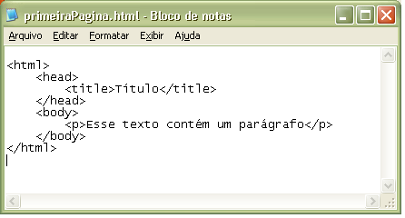
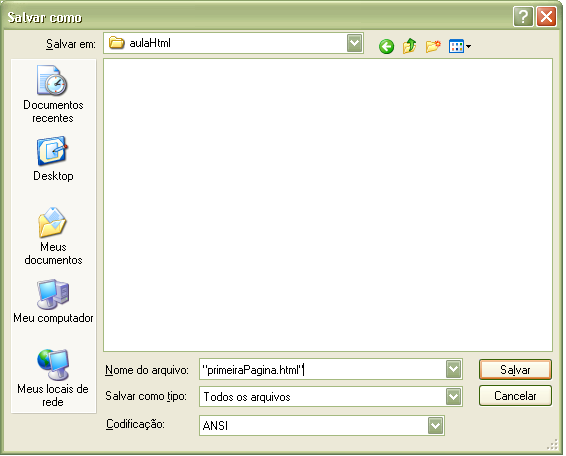
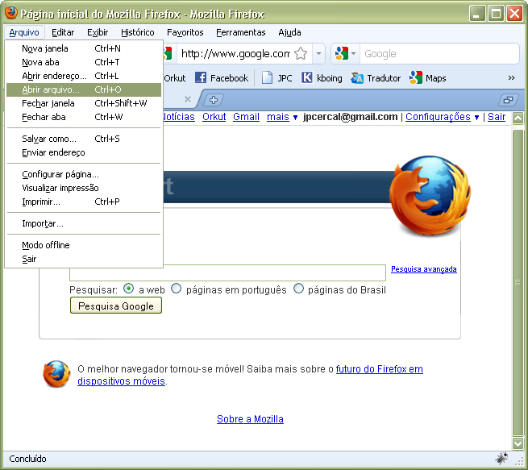
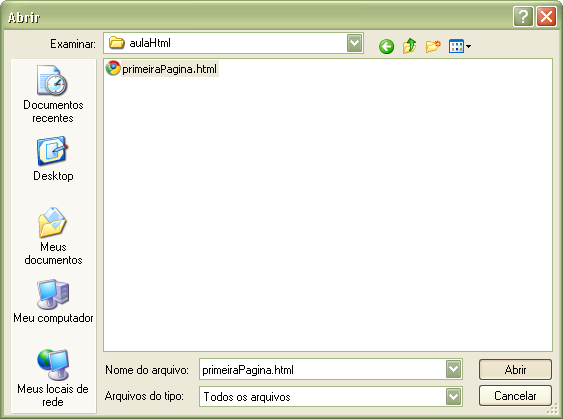

Assuming you've already read the [Introduction to HTML](),
let's continue.

**What Do You Need?**

* _The desire to learn._

**What don't you need?***

* _A professional **HTML Editor**._
* _A **WEB Server.**_
* _A **Website.**_

**HTML and Compatibility**

Unlike word processors, the HTML language was not created to control the appearance of documents.

Different browsers interpret HTML in different ways. If you intend to create websites professionally, ideally
you should install several browser options on your computer
([Web Browsers]( "Web Browsers")), so
you can anticipate how your web pages will look, at least in the most commonly used browsers. Another
concern would be the end user's monitor resolution.

**How to Edit and Save**

Web pages, as mentioned, are developed using plain text, which means you just need to write the
code in a simple text-editing program (such as Windows 'Notepad') and then save it as:

**Extension**: All files (*.*), naming it with the extension **.html** (pagina**.html**) or **.htm** (pagina**.htm**).

1. **.htm:** characteristic of _DOS_ and _WINDOWS_
2. **.html:** characteristic of _UNIX_

We'll use the **.html** extension in our examples.

**Note:** if there are two documents with the same name, for example, a file called **index.html** and another,
**index.htm**, the server will always display _index.html_. Unless you change the default configuration.
[Get to Know the Apache Web Server]( "Installing the Apache web server on Linux").

Besides plain-text editors, you can use a specialized **professional HTML Editor** to edit your
pages.

**Recommended:** _If you want to be a skilled Web developer, use a plain-text editor to learn basic
HTML. And once you know what each tag does, use an editor to speed up the development process._


**Example:**

```html
<html>
    <head>
      <title>Título</title>
    </head>
    <body>
        <p>Esse texto contém um parágrafo</p>
    </body>
</html>
```

Let's go through the explanation step by step:

1. _This tag tells your browser that this is the beginning of an HTML document._
2. _Starts the head_
3. _Sets the title_
4. _Ends the head_
5. _Starts the body_
6. _Inserts text with a paragraph_
7. _Ends the document body_
8. _Ends the html document_

Only the document's body (_body_) is displayed in the browser.



We'll use the [CamelCase]( "The CamelCase Convention") convention for
file names, so save the file as **"primeiraPagina.html"**.



**Opening the document in your browser**

Follow the steps below:





**Research Sources:**

* _http://www.clem.ufba.br/tuts/html/c02.htm_
