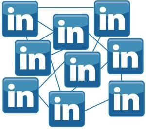

The largest professional networking site is broadening its horizons, on the 18th _LinkedIn_ announced the
purchase of the mobile application _Pulse_, which works as an aggregator of internet content, such as news and blogs.

_LinkedIn_ paid 90 million dollars for the application that emerged from an academic project by _Ankit_
and _Akshay_ in 2010 at _Stanford_ University and was currently held by the California company
_Alphonso Labs._

The amount will be paid 90% in shares and 10% in cash, the social network said, according to it, Pulse has more than 30
million users from around 190 countries and distributes content from more than 750 publishers.

"We believe _LinkedIn_ can be the ultimate professional content platform – where all professionals
can consume information and publishers can share their content", says _Deep Nishar_, vice president of
products at _LinkedIn_, in a note published on the social network's official blog.

"We believe we can help all professionals make smarter, better-informed decisions by leveraging
the excellent business knowledge circulating through _LinkedIn_ in the form of news, _posts_, updates
on different industries, discussions or comments, Pulse is the perfect complement to this vision", he adds.

How _LinkedIn_ will integrate with Pulse is still unknown, but Pulse's creators guarantee that the
application won't undergo changes in the short term.

"For now, the Pulse app will stay the same as always, and the two teams (from _LinkedIn_ and _Pulse_) are
excited to be able to work together to create new tools that are "_cool_" and useful", say
_Akshay_ _Kothari_ and _Ankit Gupta_ on the Pulse blog.

All we can do is wait and see how _LinkedIn_ turns out.

> And do you want to add anything to this news? Feel free to leave your comment.
