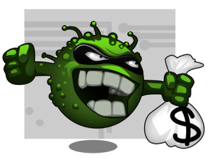

Viruses are known for the damage they do to our computers, but this week a virus was reported that
damages our bank accounts and also causes insecurity about using a tool that's already part of many
Brazilians' daily lives, internet banking.

According to an analysis by the security site
"[Linha Defensiva](http://www.linhadefensiva.org/2013/04/virus-altera-boletos-na-web-e-pagamento-cai-em-conta-indevida/)",
the virus active in Brazil manipulates the "payment code line" of bank payment slips accessed on the internet, modifying the
account's numerical code and thus diverting payment to another account.

Although it has been identified, the virus has been manipulating payment slips for three weeks, when a payment slip is accessed online on
any website it changes the branch code and the payee's account to someone else's account. Fraudulent payment slips
are difficult to identify because they have the same characteristics as an original slip, such as the bank's
logo, the bank number, the payment amount and the due date, but the slip's barcode doesn't
work, reporting an error and forcing the victim to type in the numerical code.

Even those who don't use internet banking, such as people who request duplicate payment slips and shop
on the internet, can be affected by the virus.

Pay attention when generating a payment slip, whenever this virus modifies the documents' payment code lines it uses
similar numbers, so be alert, it's advisable to generate more than one slip for different payments and notice whether the
numbers are similar. There may also be inconsistencies between the banks' logos and their correct identification codes.

> If you've ever been a victim of this type of attack, share with us, because this way your comment will be a
warning to other people.
