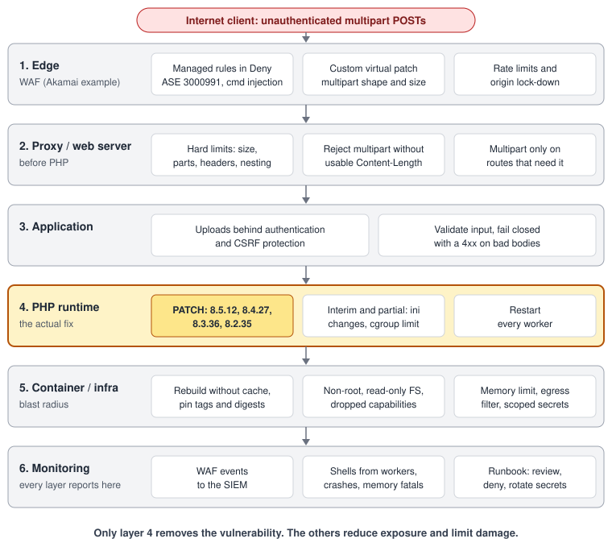

Two critical flaws in the PHP runtime itself were disclosed on October 21, 2026: CVE-2026-109618 and CVE-2026-109619, nicknamed “PHP2Shell.” Both are CVSS 9.2 (v4.0) and can lead to unauthenticated remote code execution. Disclosure was moved up a day after the IDs leaked ([PHP Foundation](https://thephp.foundation/blog/2026/10/21/todays-php-security-release-and-how-were-strengthening-php-security/)). The bug is in PHP core, so your framework does not matter.

**The short version:** update PHP to 8.5.12, 8.4.27, 8.3.36 or 8.2.35, restart every worker, and verify the running version. A WAF buys time; it is not a patch.

## What is affected

Both CVEs are fixed by **8.5.12, 8.4.27, 8.3.36 and 8.2.35**; older releases on those branches are affected. For older branches the sources differ:

- The GitHub advisories ([GHSA-w8hw-w9fx-j79w](https://github.com/php/php-src/security/advisories/GHSA-w8hw-w9fx-j79w), [GHSA-6wmf-4rv5-p3rp](https://github.com/php/php-src/security/advisories/GHSA-6wmf-4rv5-p3rp)) list 8.2 to 8.5; Google Cloud says everything from 5.4 through 8.5.11 is vulnerable ([Google Cloud](https://cloud.google.com/blog/products/identity-security/responding-to-core-php-vulnerabilities-cve-2026-109618-cve-2026-109619)).
- Upstream ships no release for 8.1 or earlier, only source backports for 7.4, 8.0 and 8.1 (links below).
- Some vendors backport: Ubuntu (14.04 to 26.10, the oldest via Ubuntu Pro) and Zend (ZendPHP for 7.2 to 8.1) ([Ubuntu](https://ubuntu.com/security/CVE-2026-109618), [Zend](https://www.zend.com/php-security-center/CVE-2026-109618)).

Treat a vendor backport as a bridge, not a plan.

## How the flaws work

**CVE-2026-109618 (OOM corruption).** PHP uses `longjmp()` to abandon a request that runs out of memory. In some contexts request memory is reachable before it is initialized, so a failed allocation leaves the request in an invalid state that shutdown then uses. Memory can be exhausted within apparent limits through multipart parsing: bodies without a usable length that slip past `post_max_size`, parts with unlimited headers, and empty file controls that skip `max_file_uploads`.

**CVE-2026-109619 (stale global state).** A persistent worker keeps global state pointing at request memory. If a fatal error interrupts the request before the reset, a later operation uses the freed pointer (use-after-free). It needs a producer and a consumer, usually different HTTP requests on the same worker. Confirmed consumers are INI diagnostics and session upload progress (on by default).

**Impact by SAPI:**

- **Apache mod_php** is the worst case: for 109618, shutdown runs even when startup failed, so it is reachable before application code, with default limits.
- **PHP-FPM** exits a child when startup fails, blunting the simplest sequence, but application-level paths remain (a session-lifecycle RCE was validated for 109619).
- **FrankenPHP** and **LSAPI** are possibly susceptible, unvalidated.

Impact: code execution as the web worker.

## Is it being exploited?

The PHP team found no functional exploit among the leaked PoCs at release, but watchTowr reports exploitation attempts from October 21 and a PoC tool in circulation ([watchTowr](https://watchtowr.com/intelligence/php-remote-code-execution-php2shell/)). Plan as if exploitation is active.

## Reduce exposure at the edge

**A WAF is a compensating control, not a fix.** It does not update PHP and only matches known shapes. Akamai agrees: prompt patching is the most effective defense ([Akamai](https://www.akamai.com/blog/security-research/critical-remote-code-execution-vulnerabilities-php-core)). See also [A WAF Is Not a Patch]( "A WAF Is Not a Patch").

Six layers; only the fourth removes the flaw:

1. **Edge (WAF):** managed rule, virtual patch, rate limits, origin lock-down.
2. **Proxy/web server:** hard caps on size, parts and headers; reject multipart without a length.
3. **Application:** authenticated uploads only where needed.
4. **PHP runtime:** patch and restart.
5. **Container:** non-root, read-only filesystem, memory limit, egress filter.
6. **Monitoring:** SIEM events, host telemetry, a runbook.

### Akamai as the worked example

Akamai released Adaptive Security Engine rule **3000991** and says its command-injection rules mitigate weaponized payloads.

1. **Prerequisites:** list the policies, hostnames and paths that legitimately accept `multipart/form-data`.
2. **Managed protection:** confirm rule 3000991 is in Deny, not Alert; Akamai does not state the default.
3. **Custom rules, Alert first:**

| Rule | Purpose | Confidence |
|---|---|---|
| A. Multipart outside allow-list | Deny multipart POSTs where no uploads exist | Strong |
| B. Chunked multipart | Deny multipart with `Transfer-Encoding: chunked` or no `Content-Length` (my inference) | Strong, if no client chunks |
| C. Oversize multipart | Deny `Content-Length` above the per-path cap | Strong for declared length only |
| D. Upload-progress field | Alert on `PHP_SESSION_UPLOAD_PROGRESS` | Weak, easily renamed |
| E. Inspection gap | Alert on multipart above the WAF inspection limit | Closes a blind spot |

4. **Rate policy** per client IP on multipart paths, since 109619 needs two requests. Start in Alert, from your observed peak.
5. **Roll out:** baseline traffic, deploy in Alert, review daily, fix false positives by scoping the rule, then promote one rule at a time to Deny while watching 4xx and upload success.
6. **Lock down the origin:** allow only Akamai (Site Shield, or an allow-list plus shared secret or mTLS), and verify from outside that the origin IP does not answer.
7. **Logging:** send security events to your SIEM and alert on rule hits, multipart volume above baseline, 5xx spikes after a multipart burst, and producer-then-consumer request pairs. A shell spawned by php-fpm or Apache means compromise.

Never test with exploit code or the public PoC; send benign requests (such as `curl -F 'a=1'` on staging) and confirm the intended rule fired.

## Patch PHP

Upgrade to **8.5.12, 8.4.27, 8.3.36 or 8.2.35** ([php.net](https://www.php.net/archive/2026.php#2026-10-21-5)). On older branches use a vendor backport, the source backports ([7.4](https://github.com/php/php-src/tree/PHP-7.4-CVE-2026-109618-109619), [8.0](https://github.com/php/php-src/tree/PHP-8.0-CVE-2026-109618-109619), [8.1](https://github.com/php/php-src/tree/PHP-8.1-CVE-2026-109618-109619)), or migrate.

Distro packages keep the old version number; check the vendor tracker ([Debian](https://security-tracker.debian.org/tracker/CVE-2026-109618), [Ubuntu](https://ubuntu.com/security/CVE-2026-109618), [Red Hat](https://access.redhat.com/security/cve/cve-2026-109618)), not `php -v`. For Docker, pin the fixed tag (such as `php:8.5.12-fpm-alpine`), ideally by digest, and rebuild with `docker build --pull --no-cache`. Scanners can miss these CVEs, since PHP in official images is not a system package.

Restart every PHP-FPM, Apache and worker process, then verify with `php -v` and `php-fpm -v` on each host and container. In CI, fail builds below the fixed `PHP_VERSION`. Patch internet-facing `mod_php` first. If compromised, rotate secrets and rebuild from clean images.

If you run PHP 8.1 or older, how long will your migration take?

**References:** [GHSA-w8hw-w9fx-j79w](https://github.com/php/php-src/security/advisories/GHSA-w8hw-w9fx-j79w), [GHSA-6wmf-4rv5-p3rp](https://github.com/php/php-src/security/advisories/GHSA-6wmf-4rv5-p3rp), [PHP Foundation](https://thephp.foundation/blog/2026/10/21/todays-php-security-release-and-how-were-strengthening-php-security/), [Google Cloud](https://cloud.google.com/blog/products/identity-security/responding-to-core-php-vulnerabilities-cve-2026-109618-cve-2026-109619), [Akamai](https://www.akamai.com/blog/security-research/critical-remote-code-execution-vulnerabilities-php-core), [watchTowr](https://watchtowr.com/intelligence/php-remote-code-execution-php2shell/).
