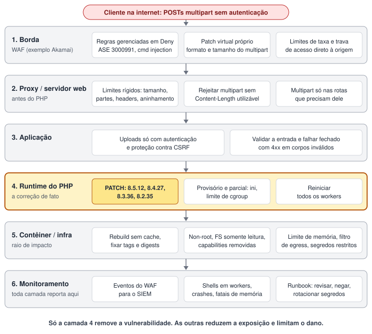

Duas vulnerabilidades críticas no próprio runtime do PHP foram divulgadas em 21 de outubro de 2026: CVE-2026-109618 e CVE-2026-109619, apelidadas de “PHP2Shell”. Ambas têm CVSS 9.2 (v4.0) e podem levar a execução remota de código sem autenticação. A divulgação foi antecipada de 22 de outubro depois que os IDs dos CVEs vazaram em 20 de outubro ([PHP Foundation](https://thephp.foundation/blog/2026/10/21/todays-php-security-release-and-how-were-strengthening-php-security/)).

Não se trata de um bug em um framework ou plugin. Está no núcleo do PHP, então tanto faz se você usa WordPress, Laravel, Symfony, Zend ou um script de dez anos atrás.

Atualizei este post depois de ler os dois advisories de segurança do GitHub, o texto da PHP Foundation e as páginas dos fornecedores listadas nas referências.

**A versão curta:** atualize o PHP para 8.5.12, 8.4.27, 8.3.36 ou 8.2.35, reinicie todos os workers e confira a versão que está de fato em execução. Um WAF pode ganhar tempo, mas não é uma correção. A seguir: como as falhas funcionam, o que um WAF e a defesa em profundidade podem e não podem fazer (com um mapa de mitigação e um exemplo com Akamai), como aplicar o patch no PHP e nas imagens Docker, como verificar e as fontes.

## O que é afetado

As versões corrigidas são **PHP 8.5.12, 8.4.27, 8.3.36 e 8.2.35**. Os dois CVEs são corrigidos pelas mesmas versões. Qualquer versão anterior a essas na mesma branch é afetada.

Para as branches mais antigas, as fontes divergem, e esta é a parte incômoda:

- Os advisories do GitHub ([GHSA-w8hw-w9fx-j79w](https://github.com/php/php-src/security/advisories/GHSA-w8hw-w9fx-j79w) e [GHSA-6wmf-4rv5-p3rp](https://github.com/php/php-src/security/advisories/GHSA-6wmf-4rv5-p3rp)) listam as branches 8.2 a 8.5.
- O Google Cloud diz que “todas as versões do PHP da 5.4 até a 8.5.11” são vulneráveis ([Google Cloud](https://cloud.google.com/blog/products/identity-security/responding-to-core-php-vulnerabilities-cve-2026-109618-cve-2026-109619)).
- O PHP upstream não publica release para a 8.1 ou anteriores. A equipe de segurança publicou backports mínimos do código-fonte para a 7.4, 8.0 e 8.1 como branches no php-src, para quem compila a partir do código-fonte e não tem um fornecedor com suporte de longo prazo (links na [seção de correção](#aplique-o-patch-no-php)).
- Alguns fornecedores entregam pacotes com backport para branches antigas: a Ubuntu lista pacotes corrigidos do 14.04 ao 26.10 (os mais antigos via Ubuntu Pro) e a Zend lista builds do ZendPHP para 7.2, 7.3, 7.4 e 8.1. A página da Zend diz que a falha afeta todas as versões 5, 7 e 8.0/8.1 do PHP ([Ubuntu](https://ubuntu.com/security/CVE-2026-109618), [Zend](https://www.zend.com/php-security-center/CVE-2026-109618)).

Então, se você está na 8.1, 7.x ou 5.x, não existe release upstream. Você consegue um backport do fornecedor, compila a partir da branch de backport ou migra para uma branch suportada. Trate a rota do fornecedor como uma ponte, não como um plano.

## Como as falhas funcionam

Os advisories descrevem dois bugs diferentes de ciclo de vida de memória. Mantenho este resumo no nível que os advisories publicam e deixo de fora, de propósito, os detalhes de payload.

**CVE-2026-109618, “RCE via corrupção por OOM”.** O PHP usa `longjmp()` para abandonar uma requisição quando fica sem memória. Em alguns contextos, a memória da requisição fica acessível antes de ser totalmente inicializada. Se uma alocação falha nesse momento, a requisição fica em um estado inválido, e o encerramento da requisição então lê ou toma decisões com base nele. A alocação que falha não precisa ter relação com a memória inválida.

O advisory lista várias formas de estourar a memória de uma requisição mantendo-se dentro dos limites aparentes, todas em torno do parsing de multipart: um corpo multipart sem um tamanho declarado utilizável que escapa do `post_max_size`, partes com um número ilimitado de headers e controles de arquivo vazios que não contam para o `max_file_uploads`, mas ainda assim constroem arrays de metadados.

**CVE-2026-109619, “RCE via estado global obsoleto”.** Um worker persistente mantém algum estado global (de erro, sessão, objeto, extensão) que aponta para memória pertencente a uma requisição. Se um erro fatal, inclusive um de falta de memória, interrompe a requisição antes de esse estado ser reiniciado, o heap é liberado enquanto o worker ainda o referencia. Uma operação posterior, executada antes da inicialização normal da requisição, pode então usar o ponteiro obsoleto: um use-after-free. É preciso um produtor e um consumidor, e nos casos demonstrados eles são requisições HTTP diferentes tratadas pelo mesmo worker.

Os consumidores confirmados são os diagnósticos de INI emitidos antes da inicialização da requisição e o progresso de upload de sessão. O `session.upload_progress.enabled` vem ativado por padrão e não é preciso chamar `session_start()`. O caso demonstrado mais forte é o PHP 8.5 com `fatal_error_backtraces` ativado.

### O impacto depende da SAPI

- **Apache mod_php** é o pior caso para o 109618: o encerramento da requisição roda mesmo quando a inicialização falhou, então a falha é alcançável antes de qualquer código da aplicação executar. O RCE foi demonstrado via HTTP com os limites padrão de memória e de entrada. O caso do backtrace do 109619 também foi confirmado no mod_php.
- **PHP-FPM** encerra um processo filho quando a inicialização da requisição falha, o que atenua a sequência mais simples. Os advisories o descrevem como suscetível por caminhos no nível da aplicação. Para o 109619, um RCE no ciclo de vida da sessão foi validado no FPM, mas exige uma operação adequada da aplicação. Para o 109618, o advisory diz que nenhum exploit completo para FPM foi demonstrado, enquanto a PHP Foundation diz que o RCE foi confirmado no FPM por caminhos de código no nível da aplicação.
- **FrankenPHP** provavelmente é suscetível ao 109618 por análise do código-fonte, e **LSAPI** é um candidato condicional. Nenhum dos dois foi validado.

O impacto confirmado é execução de código sem autenticação com a conta do worker web. Para o 109619, o advisory também lista use-after-free de heap e divulgação de memória. A confiabilidade depende do build do PHP, das extensões, do frontend e do layout do alocador.

## Está sendo explorado?

- Uma das empresas que reportaram as falhas publicou um vídeo de prova de conceito por engano depois do vazamento, e cópias andaram circulando. A equipe de segurança do PHP diz que analisou as PoCs que apareceram e não encontrou um exploit funcional na hora do release ([PHP Foundation](https://thephp.foundation/blog/2026/10/21/todays-php-security-release-and-how-were-strengthening-php-security/))
- A watchTowr conta outra história: ela relata tentativas de exploração na internet a partir de 21 de outubro, além de uma ferramenta de PoC chamada “PHP2Shell” em circulação ([watchTowr](https://watchtowr.com/intelligence/php-remote-code-execution-php2shell/)). Mesmo que você pese isso como a versão de um único fornecedor, o caminho seguro é planejar como se a exploração estivesse ativa.
- Já existem repositórios públicos que dizem conter regras de detecção ou indicadores. Tenha cautela antes de levar qualquer coisa deles para as suas ferramentas.

## Reduza a exposição na borda: WAF e defesa em profundidade

**Um WAF é um controle compensatório, não uma correção.** O bug está no interpretador do PHP. Uma regra na borda não atualiza o PHP, não ajuda se a origem puder ser alcançada contornando a borda e só reconhece formatos de requisição que alguém já viu. A própria Akamai diz o mesmo: “a defesa mais eficaz continua sendo a aplicação rápida dos patches do fornecedor” ([Akamai](https://www.akamai.com/blog/security-research/critical-remote-code-execution-vulnerabilities-php-core)). Use os controles abaixo para ganhar tempo, reduzir o raio de impacto e perceber se algo passou. O patch vem na próxima seção. Para o caso geral, veja meu post [Um WAF Não É um Patch]( "Um WAF Não É um Patch").

### O mapa

As seis camadas abaixo formam a defesa inteira. O tráfego atravessa cinco delas, de cima para baixo, e todas reportam para a sexta. Só a camada 4 remove a vulnerabilidade. As camadas 1 a 3 reduzem a chance de uma requisição hostil chegar ao parser de multipart, a camada 5 limita o que um worker comprometido consegue fazer e a camada 6 é como você descobre que as outras falharam.



Cada camada corresponde a um princípio de segurança desde a concepção (security by design):

| Camada | O que faz | Princípio |
|---|---|---|
| 1. Borda (WAF) | Regra gerenciada, patch virtual próprio, limites de taxa, trava de acesso à origem | Defesa em profundidade, falhar de forma segura. Um controle independente na frente da aplicação, e a trava na origem impede que a borda seja contornada. |
| 2. Proxy / servidor web | Limites rígidos de tamanho, partes, headers e aninhamento; rejeitar multipart sem tamanho utilizável | Padrões seguros, falhar de forma segura. O próprio advisory do PHP manda limitar isso no frontend. Os limites valem mesmo que o WAF esteja mal configurado. |
| 3. Aplicação | Uploads autenticados e protegidos contra CSRF só onde necessário; entrada validada; falhar fechado | Privilégio mínimo. Usuários anônimos não chegam a caminhos multipart de que não precisam. No mod_php, o CVE-2026-109618 dispara antes de o código da aplicação rodar, então esta camada reduz a exposição, mas não a elimina. |
| 4. Runtime do PHP | Patch, reinício, ajustes provisórios de ini | Gestão de patches. A única camada que corrige a causa raiz. Os ajustes provisórios de ini são parciais. |
| 5. Contêiner / infraestrutura | Rebuild, non-root, sistema de arquivos somente leitura, limite de memória, filtro de egress, segredos restritos | Privilégio mínimo, redução do raio de impacto. Parta do princípio de que o parser pode ser comprometido: um worker que não consegue iniciar ferramentas, gravar em disco nem acessar a rede vale pouco para um atacante. |
| 6. Monitoramento / resposta | Eventos para um SIEM, telemetria de host, um runbook | Observabilidade. As regras terão lacunas, e o tempo de detecção limita o dano. |

### Akamai como exemplo prático

Uso o Akamai App and API Protector porque é o fornecedor cujas orientações li para este post. A Akamai lançou a regra **3000991 v1** do Adaptive Security Engine (“PHP Remote Code Execution Attack Detected (CVE-2026-109618, CVE-2026-109619)”) e diz que suas regras existentes de command injection mitigam payloads armados. A mesma lógica vale para outros WAFs.

Uma ressalva sobre o que segue. Os nomes de menus e as condições de correspondência disponíveis variam conforme o contrato e a versão do produto, então confirme cada um no seu próprio Control Center.

**1. Pré-requisitos.** Identifique as políticas de segurança e os hostnames que ficam na frente de aplicações PHP, porque as regras se associam a políticas e um hostname esquecido é uma aplicação desprotegida. Identifique quais caminhos aceitam `multipart/form-data` de forma legítima: todo o resto é candidato a “sem multipart”. Confirme que a origem não pode ser alcançada contornando a Akamai (passo 6) antes de qualquer outra coisa.

**2. Confirme que a proteção gerenciada está ligada, e em Deny.** Encontre a regra 3000991 na visão do Adaptive Security Engine da política e confira que a ação é Deny, e não Alert. A Akamai diz que clientes do App and API Protector estão protegidos, mas o post dela não informa a ação padrão por política, então não presuma. Ative a atualização automática das Rapid Rules ou revise as regras novas diariamente durante o incidente. Mantenha em Deny os grupos de command injection, web attack tool, web protocol attack e file inclusion: eles importam para o que acontece depois que um payload chega, não para o gatilho de corrupção de memória em si. O Google Cloud recomenda as categorias equivalentes para o Cloud Armor. Se precisar de uma exceção, restrinja-a a um caminho e a uma regra, nunca a um grupo inteiro.

**3. Regras customizadas como patch virtual, primeiro em Alert.** O objetivo é reduzir a superfície de ataque multipart alcançável usando apenas condições que uma borda consegue avaliar com confiabilidade.

| Regra | Finalidade | Confiança |
|---|---|---|
| A. Multipart fora da lista de permitidos | Negar POSTs `multipart/form-data` para qualquer caminho que não precise de upload | Forte: só header e caminho |
| B. Multipart com chunking | Alertar e depois negar `multipart/form-data` com `Transfer-Encoding: chunked` ou sem `Content-Length` | Forte, se nenhum dos seus clientes envia uploads com chunking. É uma inferência minha a partir do advisory, não uma recomendação dele |
| C. Multipart grande demais | Negar multipart cujo `Content-Length` esteja acima do limite do caminho | Forte para o tamanho declarado, silenciosa sobre o tamanho decodificado |
| D. Campo de progresso de upload | Alertar sobre o nome de campo `PHP_SESSION_UPLOAD_PROGRESS` no corpo | Fraca: limitada pela inspeção de corpo, desnecessária para o CVE-2026-109618, fácil de renomear |
| E. Lacuna de corpo grande demais | Alertar sobre corpos multipart maiores que o limite de inspeção do WAF | Fecha o ponto cego do “o WAF nunca leu isso” (o Google Cloud sugere o mesmo tipo de regra) |

**4. Controles de taxa.** Adicione uma política de taxa para POSTs em caminhos que aceitam multipart, por IP de cliente. O CVE-2026-109619 precisa de uma requisição produtora seguida de uma consumidora, então rajadas são um sinal utilizável. Parta do pico legítimo que você observou, não de um número chutado, e comece em Alert.

**5. Evolua de Alert para Deny e teste.** A ordem é o ponto:

1. Linha de base: registre o tráfego multipart atual por dois a sete dias, se puder.
2. Implante as regras customizadas em Alert.
3. Revise os eventos todo dia, agrupados por regra, caminho, cliente e user agent.
4. Diante de um falso positivo, restrinja ou corrija a regra. Nunca desative o grupo.
5. Quando uma regra estiver limpa pelo período que você escolheu, promova-a para Deny, uma regra por vez, começando pela de menor risco.
6. Acompanhe a taxa de 4xx, a taxa de sucesso de uploads e os chamados de suporte. Em caso de regressão, volte para Alert e guarde as evidências.
7. Mantenha as regras até o PHP estar corrigido em todo lugar; depois aposente-as ou mantenha-as como hardening.

Espere falsos positivos de uploads legítimos grandes, formulários extensos com muitos campos de array, barras de progresso de upload e clientes que enviam multipart com chunking. Mantenha uma lista curta de clientes conhecidos e confiáveis (apps móveis, integrações) e teste-os antes de cada promoção para Deny.

Não rode código de exploit nem a PoC pública para testar suas regras, nem em produção nem em staging. Ela pode ser maliciosa, e um teste bem-sucedido derruba ou compromete workers. Use requisições sintéticas inofensivas contra um hostname de staging na mesma política. São exemplos para adaptar; os hostnames e caminhos são placeholders:

```shell
# POST multipart para um caminho que NÃO deveria aceitar multipart (espere a regra A disparar)
curl -sS -o /dev/null -w '%{http_code}\n' -F 'a=1' https://staging.example.com/api/no-uploads-here

# Multipart com chunking (espere a regra B disparar)
curl -sS -o /dev/null -w '%{http_code}\n' -H 'Transfer-Encoding: chunked' \
  -F 'file=@small.txt' https://staging.example.com/upload
```

Depois procure cada teste em Security Events pelo número de referência da página de negação e confirme que a regra esperada disparou com a ação esperada.

**6. Trave o acesso à origem.** Sem isso, tudo o que está acima é opcional para um atacante. Permita tráfego na origem apenas vindo da Akamai (Site Shield, ou uma lista de permissão no firewall da origem com os ranges da Akamai mais um segredo compartilhado ou mTLS, quando disponível), porque uma origem que aceita tráfego direto contorna o WAF por completo. Verifique, a partir de uma rede externa, que o IP da origem não responde, e revise o histórico de DNS e hostnames antigos que ainda possam apontar direto para ela.

**7. Logs e SIEM.** Envie eventos de segurança e logs de entrega (DataStream) para o seu SIEM, incluindo ID da requisição, hostname, caminho, método, IP do cliente, `Content-Type`, `Content-Length`, `Transfer-Encoding`, código de resposta, IDs das regras que casaram e as ações. Detecções úteis para adaptar:

- Qualquer hit na regra 3000991 ou nas regras customizadas A a E, agrupado por cliente e caminho.
- Contagem de POSTs multipart por caminho por hora em relação à sua linha de base.
- Picos de 5xx em origens PHP minutos depois de uma rajada multipart, o que parece crash de workers.
- Um cliente que enviou uma requisição alertada e, em segundos, uma segunda requisição ao mesmo host: o padrão produtor e consumidor do CVE-2026-109619.

Correlacione com a telemetria do host: um shell ou um processo filho inesperado iniciado por workers do php-fpm ou do Apache é indicador de comprometimento, não um evento de WAF.

## Aplique o patch no PHP

Atualizar é a única correção completa; WAF, limites no proxy e ajustes de ini só ganham tempo. Atualize para **8.5.12, 8.4.27, 8.3.36 ou 8.2.35** ([php.net](https://www.php.net/archive/2026.php#2026-10-21-5)). Na 8.1 ou anteriores não há release upstream: use um backport do fornecedor, os backports do código-fonte ([7.4](https://github.com/php/php-src/tree/PHP-7.4-CVE-2026-109618-109619), [8.0](https://github.com/php/php-src/tree/PHP-8.0-CVE-2026-109618-109619), [8.1](https://github.com/php/php-src/tree/PHP-8.1-CVE-2026-109618-109619)) ou migre.

Pacotes de distribuição mantêm o número antigo com a correção aplicada, então confira o tracker do fornecedor ([Debian](https://security-tracker.debian.org/tracker/CVE-2026-109618), [Ubuntu](https://ubuntu.com/security/CVE-2026-109618), [Red Hat](https://access.redhat.com/security/cve/cve-2026-109618)), não o `php -v`. No Docker, fixe a tag corrigida (ex.: `php:8.5.12-fpm-alpine`), idealmente pelo digest, e reconstrua com `docker build --pull --no-cache`. Scanners podem não detectar essas CVEs: o PHP das imagens oficiais não é pacote do sistema.

Reinicie todo processo PHP-FPM, Apache e worker, e confira o que de fato roda: `php -v` e `php-fpm -v` em cada host e contêiner. No CI, faça o build falhar quando o `PHP_VERSION` estiver abaixo da release corrigida da branch.

Priorize por exposição, `mod_php` exposto à internet primeiro, e prefira avançar a reverter. Se suspeitar de comprometimento, troque segredos e reconstrua de imagens limpas.

Se você roda PHP 8.1 ou anterior, quanto tempo vai levar sua migração?

**Referências:** [GHSA-w8hw-w9fx-j79w](https://github.com/php/php-src/security/advisories/GHSA-w8hw-w9fx-j79w), [GHSA-6wmf-4rv5-p3rp](https://github.com/php/php-src/security/advisories/GHSA-6wmf-4rv5-p3rp), [PHP Foundation](https://thephp.foundation/blog/2026/10/21/todays-php-security-release-and-how-were-strengthening-php-security/), [Google Cloud](https://cloud.google.com/blog/products/identity-security/responding-to-core-php-vulnerabilities-cve-2026-109618-cve-2026-109619), [Akamai](https://www.akamai.com/blog/security-research/critical-remote-code-execution-vulnerabilities-php-core), [watchTowr](https://watchtowr.com/intelligence/php-remote-code-execution-php2shell/).
