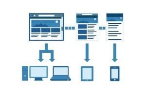

On mobile devices, research shows that 61% of visitors to a non-responsive page return to
Google's search page looking for a site that lets them view the content better.

Knowing this, the responsive _web design_ market has been consolidating and becoming unified. Because keeping all the
elements of the page's _desktop_ version viewable on other devices has already gone beyond an advantage and become
a requirement. Mobile devices are gaining strength every day, in 2012 for every five
computers sold one _tablet_ was sold, compared with 2011, when for every fourteen computers one
_tablet_ was sold.

Being on Google's first pages of search results is what everyone who has a _website_ wants,
seeking to show the best search content, Google gives priority to responsive sites, because they follow
the rule that the more visits, the better your position in search _rankings_. Previously, sites were
developed differently for each device, such as personal computers and cell phones. So
the visits your site received through a personal computer weren't the same as visits made to the site with
a cell phone. However, today with a responsive _website_ your visits have become unified, thus increasing your
level in Google's search _rankings_.

We develop our _websites_ seeking to reach the different devices present in the market, applying
[SEO]( "Search Engine
Optimization - SEO") techniques, and one of them is responsive _web_ development. If you're interested, get in touch with us through
our [contact page]( "Contact").

> Do you already have a responsive website? Have any questions? Want to add any information? Leave your comment.
