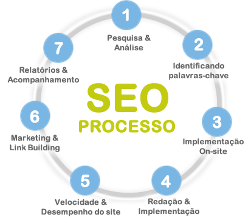

Through a set of techniques, methods and studies known as **SEO** (from the English "_Search Engine Optimization_",
which translates as "_Otimização dos Mecanismos de Busca_"), we can improve your pages' position, in
other words, when a user types a keyword into a search engine, the goal of **SEO** is to make one
(or several) of your website's pages appear among the first organic search results. Examples of
search engines are [Google](http://www.google.com.br "Google"), [Bing](http://br.bing.com/ "Bing") and
[Yahoo](http://br.search.yahoo.com/ "Yahoo").

Implementing this strategy generates an increase in qualified visits and growth in sales and leads through
the site.

SEO can be divided into two parts, internal aspects (On-Page) and external aspects (Off-Page), as we'll discuss
below.

**On-Page factors**

These refer to the site's internal aspects. For example:

* Page titles
* Meta tags
* Heading tags
* Alt attribute on images
* Domain
* File URL
* Content

**Off-Page Factors**

These refer to aspects outside the site. For example:

* Number of external links
* Quality of external links
* Anchor text of external links
* Age of a domain

**Note:** _The factors listed above are just some of the many that exist._

**The advantage of SEO?**

The main goal is to bring new visitors to your website, with an increase in the number of visits the chances
of conversion will also be higher. So good SEO work can increase your sales, the number of
visitors, the number of page views per visitor, etc.

The figure below illustrates how the SEO process is carried out:

* And do you already have a website, blog or online store?
* Want to increase the number of visits to your website?

> If you're interested, get in touch with us through our
[author page]().
