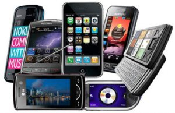

With the aim of making _smartphones_ (which have internet connectivity among their functions) more accessible to
lower-income groups, the Government approved a decree today that reduces the PIS and COFINS rates on these
devices to zero. This measure will bring consumers a price reduction of up to 30% compared with imported devices,
and only devices costing less than R$ 1,500.00 and manufactured in Brazil will qualify for the measure.

The price drop is expected next week, since an ordinance with the specifications of
the mobile devices that will qualify for this measure still needs to be published.

Among the characteristics mentioned are _wi-fi_, browser and email applications, third-generation (3G)
and fourth-generation (4G) technology, an operating system that provides a development kit for
third parties, a screen equal to or larger than 18 cm2 (square centimeters) and applications developed in the country, including
by third parties.

Besides being an incentive for consumers, it's also an opportunity for companies responsible for developing
websites to include the creation of a [responsive]( "Responsive Sites gain points in Google's search rankings") layout as a minimum requirement.

Companies that have a website should offer users a page with suitable viewing for the
[mobile device]( "Tablets as Tools in the Corporate Environment").
Brazil currently has around 65 million active smartphones, and the government expects that number to reach 130
million by next year.

> Is your company already prepared for this reality? If you have questions or can contribute any content, comment!
