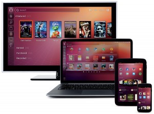

According to a survey by consultancy _IDC_, in 2012 tablet use grew by 159% in
the home and 303% in the Corporate environment compared with 2011, this growth was generated by the range of
functionality mobile devices have. Today we can manage our bank accounts, make payments
without moving, using only an internet connection and an application provided by the bank, eliminating the
possibility of losing our lunch break in a queue.

However, focusing on entertainment makes users overlook the important usefulness of these devices,
which revolutionized access to information and use in the corporate environment by allowing access to the internet and
emails, already widely used practices. With the right applications, tablets can be perfect allies for more efficient
business management.

We can mention another feature that's gaining ground in this environment, interactive sites, where customers
interact with salespeople. Seeking to offer quality service, companies are using sites to display
and sell their products 24 hours/day, adapting to customers' schedules without losing service quality. Based
on this scenario, technology agencies are paying more attention to this market niche.

With responsive sites you have the chance to change appearance and layout based on the size of the screen on which the site or
system is displayed. Allowing your site to be presented on these devices with the same quality as
a personal computer's screen.

> And does your company already have a _responsive_ site? Have you accessed your site through a tablet or smartphone? If you haven't
done that yet, do it and see how your customers are seeing your website.
