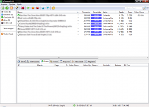

In 2011 the Torret Freak website conducted a survey of file-sharing sites that showed the
cyberlocker model dominating the 'market'. 4shared was the leader, while The Pirate Bay occupied only sixth
place.

Today the story is different, Pirate Bay has taken first place, according to Torrent Freak's analysis, the title was
acquired through the declining popularity of hosting sites such as 4Shared and Megaupload, after Megaupload's
closure and anti-piracy measures these sites saw a drop in usage. Making Pirate Bay the world's most famous and most used
site for downloading files.

Thus, files for sharing are based on BitTorrent on half of the top ten sites, compared with
just two in 2011, RapidShare and FileServe. According to Torrent Freak, the figures include only English-language
file-sharing sites and were calculated by comparing traffic and various analytical
tools, such as Compete, Quantcast and Alexa.

> Have you ever downloaded a torrent on The Pirate Bay? Would you like to add anything to our article?
Please leave your comment.
