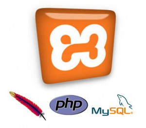

Hello, let me introduce you to my favorite package (Apache + PHP + MySQL). This is how I started; today I install
them separately.

**What is XAMPP?**

XAMPP is a package that includes the main open-source servers available, including FTP,
the MySQL database and Apache with support for the PHP and Perl languages. With it you can run well-known CMSs such
as WordPress and Drupal on the local machine (on your own computer), speeding up development. Currently
you can use XAMPP on four operating systems, which are:

* Windows
* Linux
* Mac OS X
* Solaris

Installation is straightforward, and it has a control panel that lets you start or stop services
individually. 

It also includes:

PEAR, Perl, mod_php, mod_perl, mod_ssl, OpenSSL, phpMyAdmin, Webalizer, Mercury Mail Transport System for Win32 and
NetWare Systems v3.32, JpGraph, FileZilla FTP Server, mcrypt, eAccelerator, SQLite and WEB-DAV + mod_auth_mysql.

For more information visit the
[Official XAMPP Website](https://www.apachefriends.org/pt_br/index.html "Official Xampp Website").
