# UX review — top 10 issues, remediation and evidence

Target: production https://jpcercal.com/ (PT default, `/en/` mirror), captured 2026-10-26 with Chromium over CDP (desktop 1280px, mobile 375px), light and dark themes, a keyboard Tab pass and `curl -sIL`. No critical issue was found; ranking is user impact × reach. Not covered: Safari/Firefox, a real screen-reader run, real-device performance.

This document merges three sources: the audit (`docs/ux-audit.md`), the remediation plan (`docs/ux-remediation-plan.md`, which has the full ordering, PR grouping and risks) and the annotated screenshots (`docs/ux-evidence/`). **Nothing is implemented in this PR; it is documentation only.**

## Corrections to the audit found while capturing evidence
- #10: the redirects are HTTP **308**, not 301.
- #9: the live Contact page no longer has the "Nós gostaríamos…" sentence.
- #10b: the 2013 post *does* show its date (Aug 24, 2013); what is missing is an outdated notice, not the date.
- #2: the red box in the image is the annotation; the real element has a transparent outline.
- `/contact/` is live (HTTP 200) but has no source in this repo. Resolve that before #5 and #9.
- #8, #9 and the #10 notice need the author's wording.

Suggested fix order (issue numbers): 3, 2, 5, 1, 6, 4, 7, 10, 9, 8.

| # | Issue | Severity |
|---|---|---|
| 1 | Search excerpts are code junk | High |
| 2 | Keyboard focus ring missing or invisible | High |
| 3 | No `<main>` landmark, no skip link | High |
| 4 | Touch targets too small | High |
| 5 | Language switch loses context; active item is `#` | High |
| 6 | Search input unlabeled | Medium |
| 7 | English-formatted dates on PT pages | Medium |
| 8 | Home lacks identity | Medium |
| 9 | Contact page is stale | Medium |
| 10 | Non-canonical internal links and undated legacy posts | Medium |

---

# Issue 1: Search excerpts are code junk — High
- **Where:** `/search/`, query `php`.
- **Observed:** top results are "Instalando PHPUnit no OSX 10.8 Mountain Lion" and "…no Windows"; excerpts read `1 2 3 4 5 6 7 8 9 10 … 19 <?php` — Chroma line-number gutters indexed as text.
- **Impact:** results look broken and uninformative; users cannot judge relevance, and 2013-era posts outrank current content.
- **Why included:** search is the main discovery flow for 76 posts. Fix: `data-pagefind-ignore` on `.lntd`/line-number cells (and consider code blocks), review ranking/recency.

**Evidence**

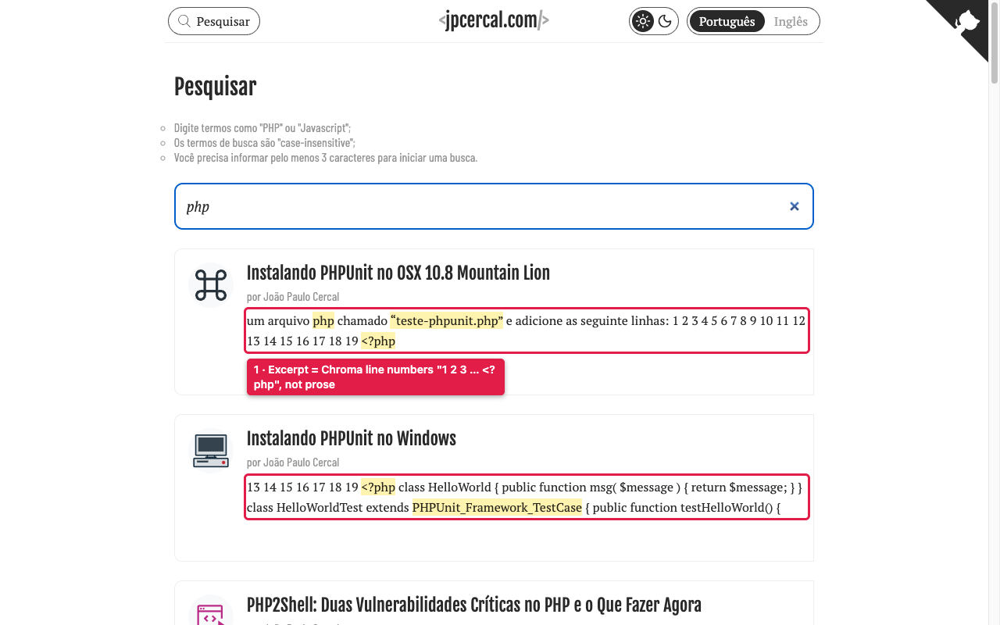

**Remediation plan**

- **Fix:** exclude Chroma line-number cells from the Pagefind index, so excerpts and word ranking only use prose and code text.
- **Rationale:** users judge relevance from the excerpt. `1 2 3 … <?php` looks broken and misleads ranking, because digits match numeric queries.
- **Approach (indexing):**
  - Confirm the markup first: `grep -o 'class="lntd"' public/**/index.html`, or inspect a built post.
  - Pagefind supports `data-pagefind-ignore` on elements. Add it to the line-number cell (`.lntd:first-child`, the `.lnt` spans). Chroma emits that markup, so either:
    - add a Hugo render hook `layouts/_default/_markup/render-codeblock.html` that emits the wrapper with the ignore attribute (needs checking against `noClasses: false` and `lineNos` in `config.yaml`), or
    - post-process in `package.json` `search:index` (e.g. a pre-step that strips line-number cells from a copy), only if the render hook is not viable.
  - Alternative: set `--exclude-selectors ".lntd:first-child"` (or a similar selector) on the `pagefind` CLI call. Verify the exact flag name with `pagefind --help` for the locked version before use.
  - Ranking is a separate, optional step: old 2013 posts outranking current ones. Consider `data-pagefind-sort` or a boost only if still a problem after the junk is gone. Do not do it speculatively.
- **Affected:** `package.json` (`search:index`), `layouts/_default/_markup/` (new), `assets/js/search.js` (read-only check of excerpt rendering).
- **Acceptance:**
  - After a full build and index, a search for `php` on `/search/` returns no excerpt matching `/(\d+\s+){5,}/`.
  - e2e (PT and EN): search `php`, assert the first 10 `.search-result` excerpts contain no run of 5 or more consecutive integers.
  - The existing real PT/EN Pagefind result tests still pass, and the Pagefind language counts in `bin/check-bilingual.py` are unchanged.

---

# Issue 2: Keyboard focus ring missing or invisible — High
- **Where:** header on all pages (Tab order: Pesquisar → logo → theme toggle → PT → EN).
- **Observed:** theme toggle computed `outline: 2px solid rgba(0,0,0,0)`, no box-shadow → no visible ring. Search/PT/EN links use `rgba(0,0,0,.84)` outline, nearly invisible on the dark theme background `rgb(25,25,25)`. Body links get the browser default. No `:focus` rule exists in `assets/scss`.
- **Impact:** keyboard users cannot see where they are (WCAG 2.4.7 / 1.4.11).
- **Why:** one shared `:focus-visible` token fixes all pages in both themes.

**Evidence**

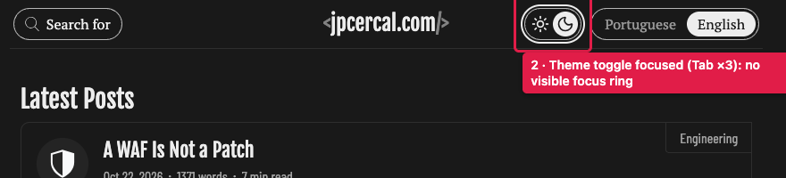

**Remediation plan**

- **Fix:** add one global `:focus-visible` style using a new token. It must have at least 3:1 contrast against the adjacent background in both themes. Remove any `outline: 0` or transparent outline.
- **Rationale:** keyboard users cannot see their position. WCAG 2.4.7 and 1.4.11 (non-text contrast).
- **Approach (CSS):**
  - Define `--color-focus` in `assets/scss/themes.scss` for light and dark. Pick values and measure them; for example a dark ink on light and a bright accent on `rgb(25,25,25)`.
  - Add in the base stylesheet: `:focus-visible { outline: 2px solid var(--color-focus); outline-offset: 2px; }`.
  - Fix the `.theme-toggle` override, which currently sets a transparent outline (find with `grep -n outline assets/scss/*.scss`).
  - Use `box-shadow` as well if `overflow: hidden` clips the outline on the toggle.
  - Do not use `:focus` (it fires on mouse click).
- **Affected:** `assets/scss/themes.scss`, base/navbar/theme-toggle SCSS, every interactive element site-wide.
- **Acceptance:**
  - e2e: Tab through the header on `/`, `/en/` and a post in both themes. For each focused element, computed `outline-style` is not `none` and `outline-width >= 2px`. Outline colour vs. background contrast >= 3:1 (compute in the test from the computed colours).
  - Visual spot check at the search link, logo, theme toggle, PT/EN, a body link and a footer link.

---

# Issue 3: No `<main>` landmark, no skip link — High
- **Where:** every page (`querySelectorAll('main').length === 0`; no "pular" link).
- **Impact:** screen-reader users cannot jump to content; keyboard users tab through 6+ header links on every page (WCAG 2.4.1, 1.3.1).
- **Why:** trivial template fix (`layouts/_default/baseof.html`) with site-wide benefit.

**Evidence**

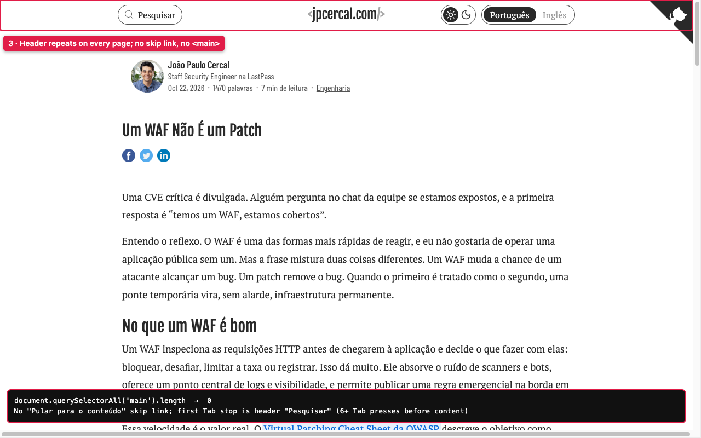

**Remediation plan**

- **Fix:** wrap primary content in a single `<main id="main-content" tabindex="-1">` on every page type. Add a first-in-DOM "Skip to content" link, visible on focus.
- **Rationale:** lets screen-reader users jump to landmarks and keyboard users skip 6+ header stops on every page. WCAG 2.4.1, 1.3.1.
- **Approach (accessibility, templates):**
  - There is no `layouts/_default/baseof.html`. Each template includes `head.html` (which opens `<body>`) and `footer.html` (which closes the page). Check every one of `index.html`, `404.html`, `posts/single.html`, `authors/single.html`, `search/list.html`, `_default/taxonomy.html`, `_default/terms.html`.
  - Put the skip link right after `<body>` in `partials/head.html`.
  - Add `<main>` once per template, between the `</header>` of `navbar.html` and the footer. The least invasive place is a `main-open`/`main-close` pair used from each template. Make sure there is exactly one `<main>` per page.
  - Add an i18n key `skipToContent` to `i18n/pt.yaml` ("Pular para o conteúdo") and `i18n/en.yaml`.
  - Style it as `sr-only`, shown on `:focus` (Tailwind `sr-only focus:not-sr-only` or equivalent). Use the focus token from #2.
- **Affected:** all layouts above, `partials/head.html`, `partials/footer.html`, `i18n/*.yaml`, a small SCSS rule.
- **Acceptance:**
  - e2e for `/`, `/en/`, a post, `/search/`, `/404.html`: `document.querySelectorAll('main').length === 1`.
  - First Tab stop is the skip link and is visible. Enter moves focus to `#main-content` (`document.activeElement.id`).
  - `html-validate` passes. The skip link `href` target exists on every page.
  - Header content is not inside `<main>`, footer content is not inside `<main>`.

---

# Issue 4: Touch targets too small — High
- **Where:** mobile 375px: header PT/EN 35×28 and 37×28, brand link 19px tall, footer nav 28px tall; post page icon links 24×24 (three, empty-text), in-article reference links 26px tall; Contact page links 22px tall; categories list links 22px tall.
- **Impact:** mis-taps on phones, especially the language and share/icon links (WCAG 2.5.8 min 24px passes only barely; 44px recommended).
- **Why:** mobile-first reader traffic; fix with padding/min-height on nav, footer, icon and list links.

**Evidence**

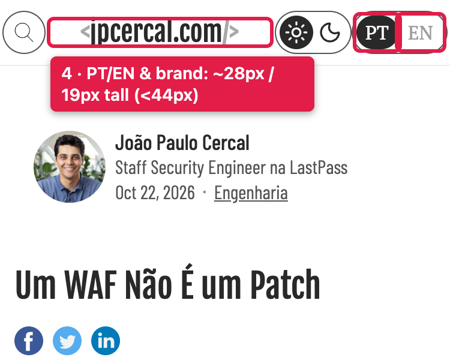

**Remediation plan**

- **Fix:** give every tap target on mobile at least 44×44 CSS px (hit area), or at least 24px with 8px spacing as the hard floor from WCAG 2.5.8. Use padding or `min-height`/`min-width`, not larger text.
- **Rationale:** mis-taps from 28px header links, 24px icon links and 22px list links on phones.
- **Approach (CSS only):**
  - Header: `.locale-list a`, `.brand`, `.search-link` get `display: inline-flex; align-items: center; min-height: 44px; min-width: 44px; padding-inline: …`. Check the one-line navbar from commit `0de494132` does not wrap at 375px; reduce the gap rather than the target.
  - Footer nav links and Contact/categories list links: `min-height: 44px; display: inline-flex; align-items: center`, or padding on the `li`/`a`.
  - Post page icon links (three 24×24): either extend the hit area using padding or a `::after` inset of `-10px` or so, and give them text names (see below).
  - In-article reference links: the 26px height comes from inline text, so it is fine under 2.5.8's inline exception; do not enlarge. Exclude them from the test.
  - Icon links with empty text need an accessible name (`aria-label` or `sr-only` text), which is an accessibility fix riding along. Check which links they are in `partials/post/article.html` before choosing the wording.
- **Affected:** `navbar.html` classes and `assets/scss` for header, footer, post blocks, taxonomy pages.
- **Acceptance:**
  - e2e at 375×667: for the selectors listed (header links, footer nav, post icon links, category list links), `getBoundingClientRect()` is >= 44×44 (or >= 24 with a documented exception).
  - No horizontal overflow at 375px (`scrollWidth <= innerWidth`) and the header remains on one line.
  - Visual snapshots updated and reviewed in light and dark.

---

# Issue 5: Language switch loses context; active item is `#` — High
- **Where:** `/contact/` → "Inglês" goes to `/en` (home), not `/en/contact/`. Posts switch correctly (`/en/a-waf-is-not-a-patch/`). On every page the active-language `Português`/`PT` link has `href="#"` (resolves to `…/page/#`).
- **Impact:** an EN reader clicking from Contact is dumped on the home page; the dead active link is announced as a link that does nothing.
- **Why:** bilingual is a core site promise. Fix `i18n-list` for pages without translations lookup and render the active locale as `aria-current` text/span.

**Evidence**

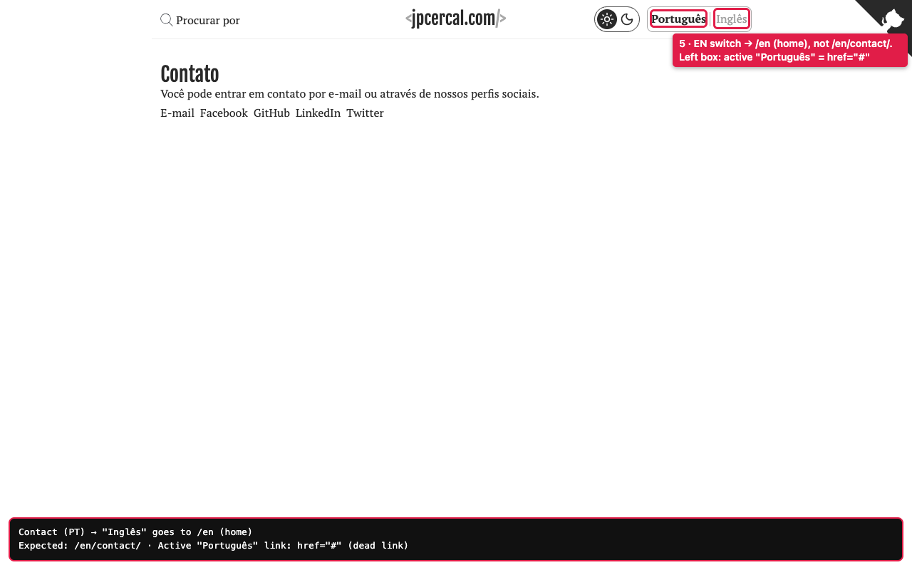

**Remediation plan**

- **Fix, two parts:**
  1. The active-language item becomes non-link text with `aria-current="true"`, not `<a href="#">`.
  2. Make the switch resolve to the counterpart page on every page type, including non-content pages such as Contact.
- **Rationale:** an EN reader pressed "Inglês" on Contact and landed on the home page, so context was lost. A `#` link announces a link that does nothing (it resolves to `…/page/#`).
- **Approach (UI, routing):**
  - Part 1: in `partials/navbar.html` lines ~82-91 replace the `<a href="#">` with `` for the active locale (both responsive variants). Keep the existing `locale-list-item--active` class and restyle if the `a` selector is used. `search.js` selects `[data-locale-switch]` links, which only exist on the inactive locale, so no JS change is expected.
  - Part 2: find how `$switch` is computed at the top of `navbar.html` (it uses `.AllTranslations` with a pager suffix). For pages with no translation entry (taxonomy, authors, search) it falls back to home. Fix the fallback to build the counterpart URL from `.RelPermalink` with the language prefix applied.
  - The `/contact/` case depends on the finding at the top of this file: the page is not in this repo's source. If it is stale and removed, part 2 is moot for Contact; keep a test for taxonomy (`/categories/`), authors and search instead.
- **Affected:** `layouts/partials/navbar.html`, `assets/scss` (locale list), `e2e/smoke.spec.js` (there are already 9 same-page switch tests; extend them).
- **Acceptance:**
  - No `a[href="#"]` and no `a[href$="/#"]` in `public/**/index.html` (add to the artifact gate in `bin/check-artifact.sh`).
  - Active locale is not a link, and carries `aria-current`.
  - e2e: switch PT→EN→PT on home, a post, a pager page, an author, a taxonomy and a term page returns to the equivalent page, not the home page (except where truly no counterpart exists).
  - `bin/check-bilingual.py` still passes (rendered switch checks).

---

# Issue 6: Search input unlabeled — Medium
- **Where:** `/search/`: `<input type=search id=search>` with only a placeholder, no `<label>`/`aria-label`.
- **Observed:** instructions are plain text; "Nenhum resultado encontrado." appears in an `aria-live` region only after typing; before typing the three instruction lines are the whole page.
- **Impact:** screen readers announce an unnamed field; placeholder disappears on input.
- **Why:** WCAG 1.3.1/3.3.2; small fix.

**Evidence**

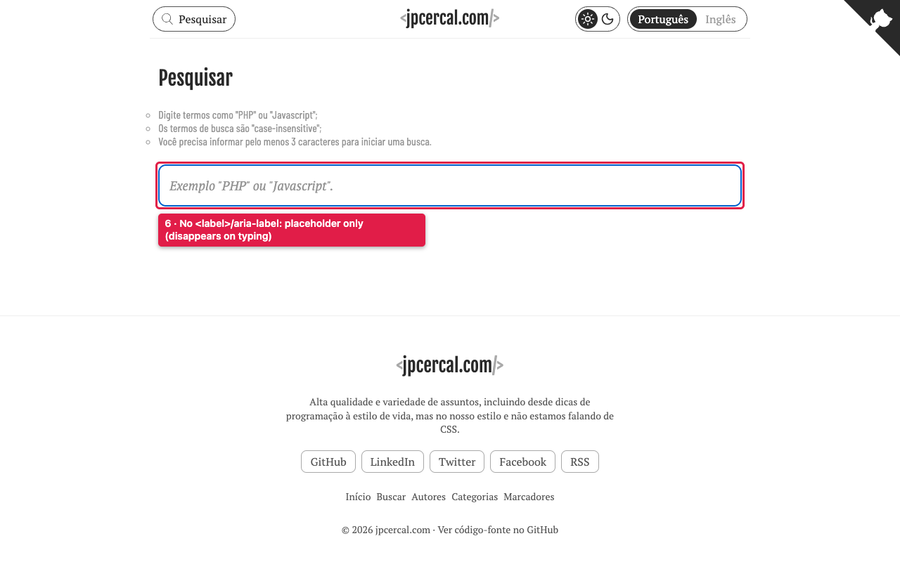

**Remediation plan**

- **Fix:** give `#search` a programmatic label. Keep a visible label or make it `sr-only` while retaining the placeholder as a hint. Announce the empty state and result counts through a polite live region.
- **Rationale:** screen readers announce an unnamed field, and the placeholder disappears once typing starts. WCAG 1.3.1, 3.3.2, 4.1.3.
- **Approach (accessibility, copy):**
  - In `layouts/search/list.html` add `<label for="search" class="sr-only">{{ i18n "searchLabel" }}</label>` (new i18n key in both languages, e.g. "Pesquisar nos posts" / "Search posts") or `aria-label`.
  - Move the instruction lines into a `
` and reference it with `aria-describedby`.
  - Keep the existing `aria-live` region, but also write a result count there ("3 resultados") from `assets/js/search.js` after each query, so non-empty states are announced as well. Keep `search.js` behavior otherwise unchanged.
- **Affected:** `layouts/search/list.html`, `i18n/*.yaml`, `assets/js/search.js` (count message only).
- **Acceptance:**
  - Accessibility tree of `/search/` and `/en/search/` shows the input with a non-empty name (Playwright `getByRole('searchbox', { name: /.+/ })` resolves).
  - e2e: type a query with results and assert the live region text contains the count; type a no-match query and assert the "no results" message.
  - `html-validate` passes; `<label for>` matches the input id.

---

# Issue 7: English-formatted dates on PT pages — Medium
- **Where:** PT home cards and post pages: `<time>Oct 22, 2026</time>` next to "1470 palavras / 7 min de leitura".
- **Impact:** inconsistent language; PT readers see `Oct`. 
- **Why:** visual/content consistency across the whole PT site; format with the page locale (`22 de out. de 2026`).

**Evidence**

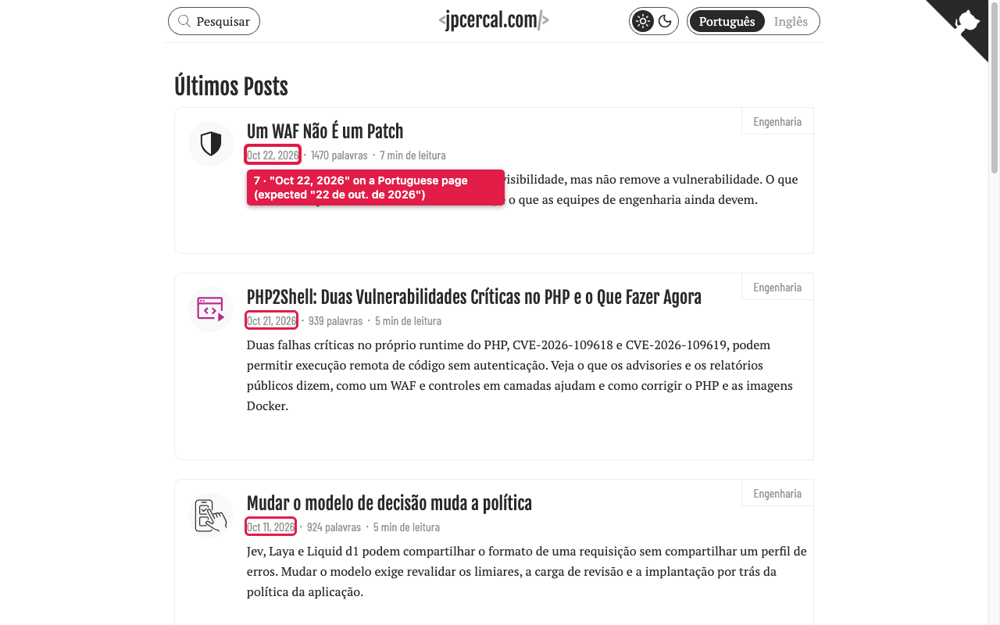

**Remediation plan**

- **Fix:** format dates with the page locale: PT `22 de out. de 2026`, EN `Oct 22, 2026`. Keep the machine-readable `datetime="YYYY-MM-DD"` as is.
- **Rationale:** a mixed-language line ("Oct 22, 2026 · 7 min de leitura") reads as a bug.
- **Approach (copy/i18n):**
  - Both `layouts/partials/post-card.html:4` and `layouts/partials/post/article.html:13` hard-code `Format "Jan 2, 2006"`.
  - Use `{{ .Date | time.Format ":date_medium" }}`, which Hugo localizes using the site language. Verify the PT output on 0.166.0 (the pinned version) is acceptable, e.g. "22 de out. de 2026"; if not, use a `dateFormat` i18n string with `time.Format` and the layout string per language.
  - Check any other date display (`grep -rn 'Format' layouts`): OG/schema ISO formats must stay untouched.
- **Affected:** `post-card.html` (used by home, taxonomy, 404), `post/article.html`, possibly `i18n/*.yaml`.
- **Acceptance:**
  - Built `public/index.html` contains no `<time …>[A-Z][a-z]{2} \d{1,2}, \d{4}</time>`; `public/en/index.html` still does.
  - e2e: PT home first card date matches `/\d{1,2} de [a-zç]+\.? de \d{4}/`.
  - `datetime` attributes unchanged. `bin/check-bilingual.py` unaffected.

---

# Issue 8: Home lacks identity — Medium
- **Where:** `/` (and `/en/`, 404 page reuse the list). H1 is "Últimos Posts"; footer/meta description is "Alta qualidade e variedade de assuntos, incluindo desde dicas de programação à estilo de vida, mas no nosso estilo e não estamos falando de CSS." Every card is category "Engenharia". Tab title is `🐴 jpcercal.com`.
- **Impact:** first-time visitors do not learn who writes or what the blog covers; the search-snippet description is generic and misleading (no lifestyle content).
- **Why:** first impression and SEO snippet; add a one-line author intro and rewrite the description.

**Evidence**

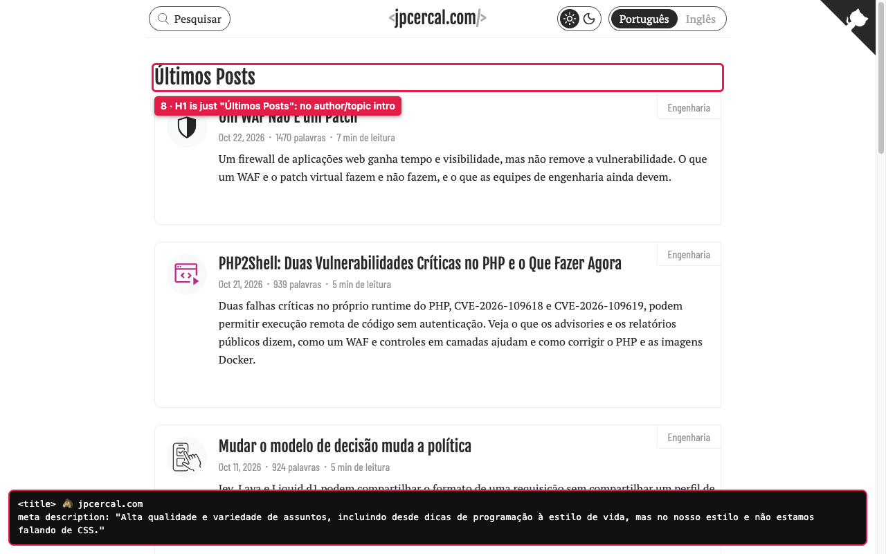

**Remediation plan**

- **Fix:**
  1. Add a short intro (1–2 sentences: who writes, what the blog covers, linking to the author page) above the post list.
  2. Replace the `description` in both languages (`config.yaml` lines 37-45) with an accurate, single-author description of 120–160 characters.
  3. Make the `<title>` meaningful, e.g. "jpcercal.com — Engenharia de software e infraestrutura" in place of the emoji-only title (check `head-meta.html` first; the emoji may be deliberate branding).
- **Rationale:** first-time visitors and search snippets currently say "lifestyle" and "our style", which does not match the content (all posts are engineering) or the single author.
- **Approach (copy, content):**
  - **The wording is the author's decision.** Do not invent a bio. Draft 2 options per language and have the author choose before merging.
  - Intro: new i18n keys (`homeIntro`) rendered in `layouts/index.html`; reuse the same heading hierarchy (keep exactly one `h1`; consider changing "Últimos Posts" to an `h2`).
  - Description: edit `config.yaml` params for `pt` and `en`. It feeds meta, OG and Twitter cards, and the footer tagline (`footer/centered.html`), so check the footer reads properly with the new text.
  - Do not touch the 404 page's use of the latest-posts list.
- **Affected:** `config.yaml`, `layouts/index.html`, `i18n/*.yaml`, `partials/head-meta*.html`, `partials/footer/centered.html`.
- **Acceptance:**
  - `<meta name="description">`, `og:description` and `twitter:description` on `/` and `/en/` equal the new text, are 120–160 characters, and contain no "lifestyle"/"CSS" joke wording.
  - Exactly one `<h1>` per page. The intro is visible above the fold at 375px and 1280px.
  - LHCI SEO category still >= its current score; `html-validate` passes.

---

# Issue 9: Contact page is stale — Medium
- **Where:** `/contact/`: listed Twitter (`twitter.com/jpcercal`), Facebook, GitHub, LinkedIn, plus "Nós gostaríamos de receber seu feedback…"; no mention of expected response, no copy of the e-mail visible beyond the link label "E-mail".
- **Impact:** dead/renamed channels, plural voice for a single-author blog, weak call to action. The page is the only feedback path since the form and comments were removed.
- **Why:** sole reader feedback route; verify each channel and reword.

**Evidence**

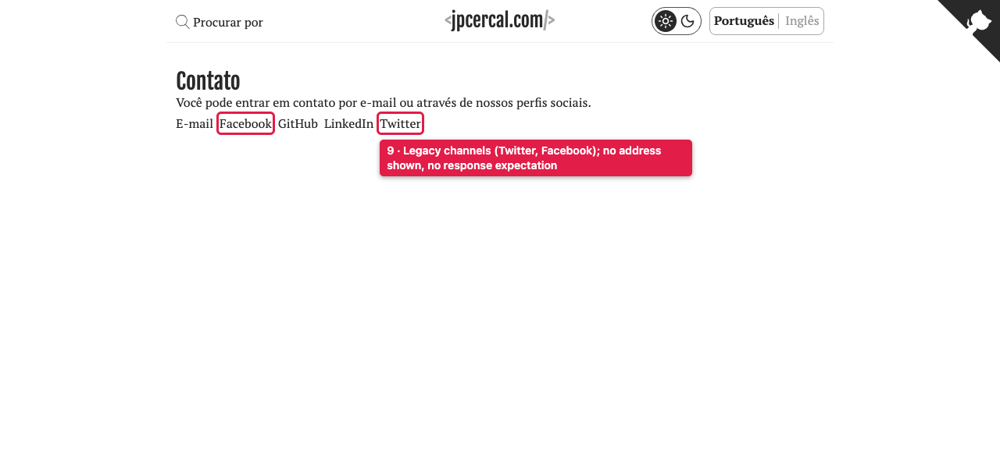

**Remediation plan**

- **Fix:** depends on the finding at the top.
  - If the live page is a stale deploy artifact: ensure the next production deploy no longer ships `/contact/` (the source has no page). Add a `static/_redirects` 301 from `/contact/` and `/en/contact/` to the author page, or to the home page, and remove it from sitemap/footer if listed. Add a test that prod build has no `public/contact/`.
  - If a contact page is wanted: create `content/contact/_index.md` and `_index.en.md` (a layout is also needed), with only verified channels, single-author voice ("Você pode…", not "Nós gostaríamos"), the e-mail address visible as text, and expected response time. Drop Twitter/Facebook unless the author confirms they are active; rename to X only if confirmed.
- **Rationale:** it is the only feedback route after the form and comments were removed (Locked decision #7), and plural voice and dead channels undermine trust.
- **Approach (content, routing):**
  - Verify each channel link with `curl -sI`; the `links` gate (lychee) only checks the built output, so it won't see a page that isn't in the build.
  - Channels come from `content/authors/` (check `partials/author-social-network.html`). Maintain them there, once, so the Author page and the Contact page agree.
- **Affected:** `content/contact/*` (if recreated), `static/_redirects`, `content/authors/*`, footer links (`partials/footer/links.html`).
- **Acceptance:**
  - Every external link on the page returns 2xx/3xx under `lychee`.
  - No occurrences of "Nós gostaríamos" / "We would like" on the site (`grep` in `public/`).
  - Either `public/contact/` is absent and `curl -sI https://jpcercal.com/contact/` returns 301 after deploy, or the page exists in both languages with working switch (see #5).

---

# Issue 10: Non-canonical internal links and undated legacy posts — Medium
- **Where:** header search `/search`, category `/categories/engineering`, author `/authors/jpcercal`, EN switch `/en` (all 301 to trailing slash; confirmed with `curl -sIL`); Contact "Procurar por" also `/search`.
- **Related:** 2013-era posts (PHPUnit on OSX 10.8) are listed without an "outdated" notice.
- **Impact:** extra round trip on every navigation (perceived speed), duplicated URL variants; readers may follow obsolete install steps.
- **Why:** cheap fix (`relLangURL` with trailing slash) plus an optional age banner for posts older than N years.

## Checked and fine
No horizontal overflow at 375px; viewport meta present; all 21 home images have alt; 404 returns HTTP 404 with a custom page; PT/EN canonical tags present; dark/light toggle works and persists.

**Evidence**

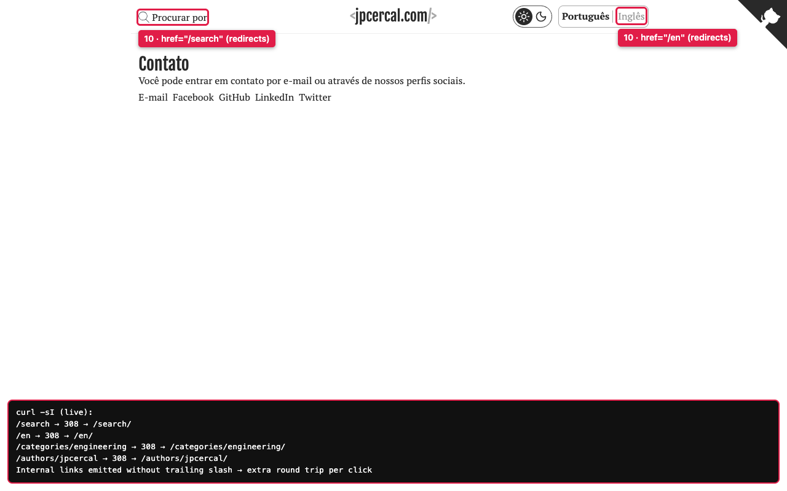

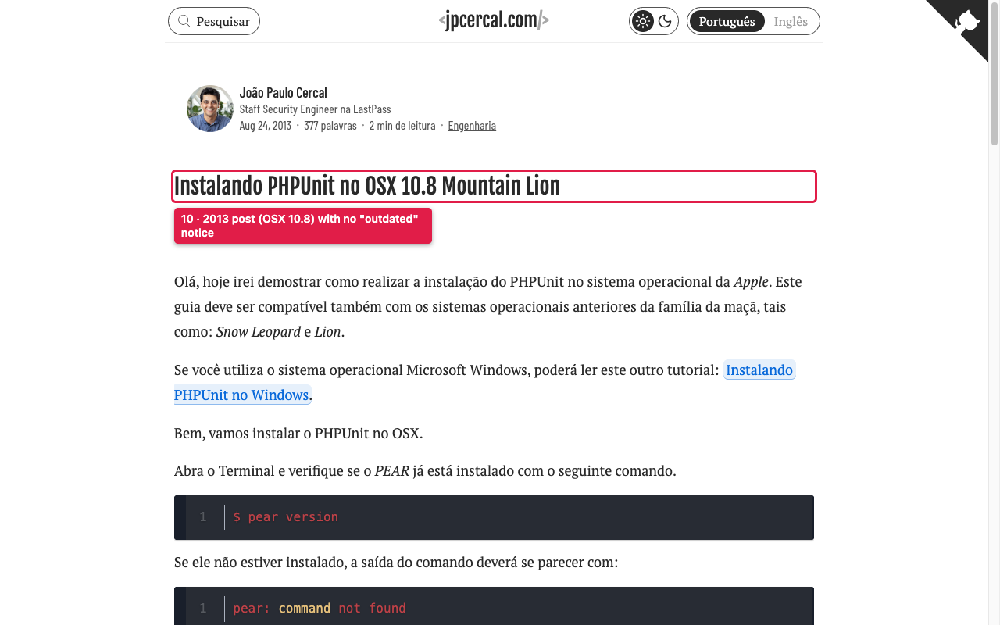

**Remediation plan**

- **Fix:**
  1. Emit canonical, trailing-slash URLs for internal links: `/search/`, `/categories/engineering/`, `/authors/jpcercal/`, `/en/`.
  2. Show an "outdated content" notice on posts older than a threshold (suggest 5 years, set via `config.yaml` param `outdatedAfterYears`), with the post date visible.
- **Rationale:** each non-canonical link costs a 301 round trip on navigation. Readers can follow obsolete install steps (PHPUnit on OSX 10.8) without noticing the post age.
- **Approach (routing, UI, copy):**
  - Links: in `navbar.html:44`, `href='{{ $baseURL }}{{ if eq $locale "en" }}en/{{ end }}search'` has no trailing slash; same for the other builders (`$switch` for `/en`, footer links, `post-card` category and author links, `post/article.html`). Use `relLangURL`/`absLangURL` on paths that end with `/`, or `.RelPermalink` of the actual page object. Find them with `grep -rn "href=" layouts | grep -v '/"'` and verify on built output.
  - Post notice: in `post/article.html`, compare `now.Year` with `.Date.Year` against the param. Render a `
` above the content with an i18n string ("Este post foi publicado em {{year}} e pode estar desatualizado."). Static build means the age is fixed at build time; the daily or per-merge build handles drift. State this in the code comment.
  - Optional front matter `outdated: false` per post for posts that are still valid. Keep this simple and don't add it until the author asks.
- **Affected:** `navbar.html`, `footer/links.html`, `post-card.html`, `post/article.html`, `authors/single.html`, `config.yaml`, `i18n/*.yaml`.
- **Acceptance:**
  - Link audit: crawl internal `href`s from `public/` and assert none resolve through a redirect (`lychee` with redirects counted as errors, or a small script that compares to the built route list). `curl -sIL` on `/`, `/en/`, a post shows no 301 for any internal link.
  - e2e: the PHPUnit-on-OSX post shows the notice; a 2026 post does not.
  - `bin/check-bilingual.py` canonical/alternate checks still pass.

